# Class Diagram: CRM/ERP Domain Model

```mermaid
classDiagram
    %% ===== BASE CLASSES =====
    class BaseEntity {
        UUID id
        Instant createdAt
        Instant updatedAt
    }

    class TenantEntity {
        UUID tenantId
        +getTenantId()
    }

    class User {
        String keycloakId
        String email
        String displayName
        UserRole role
        EmployeeFunction employeeFunction
        boolean active
    }

    class Tenant {
        String slug
        String name
        boolean active
    }

    TenantEntity --|> BaseEntity
    User --|> TenantEntity
    Tenant --|> BaseEntity

    %% ===== ENUMS =====
    class UserRole {
        <<enumeration>>
        SUPER_ADMIN
        EMPLOYER
        EMPLOYEE
        CLIENT
    }

    class EmployeeFunction {
        <<enumeration>>
        SALES
        INVENTORY
        ACHAT
        CMS
    }

    class ProspectStatus {
        <<enumeration>>
        NOUVEAU
        QUALIFIE
        CONVERTI
        PERDU
    }

    class ClientType {
        <<enumeration>>
        PROFESSIONNEL
        PARTICULIER
    }

    class OpportunityStatus {
        <<enumeration>>
        NOUVELLE
        QUALIFIEE
        NEGOCIATION
        GAGNEE
        PERDUE
    }

    class DevisRequestStatus {
        <<enumeration>>
        NOUVEAU
        EN_COURS
        CONVERTI
        REFUSEE
    }

    class DevisStatus {
        <<enumeration>>
        BROUILLON
        ENVOYE
        ACCEPTE
        REFUSE
        EXPIRE
    }

    class CommandeStatus {
        <<enumeration>>
        EN_ATTENTE
        CONFIRMEE
        EN_COURS
        LIVREE
        ANNULEE
    }

    class LivraisonStatus {
        <<enumeration>>
        PLANIFIEE
        EN_COURS
        LIVREE
        RECLAMATION
    }

    class FactureStatus {
        <<enumeration>>
        BROUILLON
        ENVOYE
        PAYEE
        PARTIELLEMENT_PAYEE
    }

    class BonCommandeStatus {
        <<enumeration>>
        BROUILLON
        ENVOYE
        CONFIRME
        EN_COURS
        LIVRE
        ANNULEE
    }

    class BonReceptionStatus {
        <<enumeration>>
        EN_COURS
        COMPLETE
        ANOMALIES
    }

    class StockMovementType {
        <<enumeration>>
        ACHAT
        VENTE
        AJUSTEMENT
        RETOUR
    }

    class PaymentMethod {
        <<enumeration>>
        ESPECES
        CHEQUE
        VIREMENT
        CARTE
        AUTRE
    }

    %% ===== CRM MODULE =====
    class Prospect {
        String name
        String email
        String phone
        String company
        String source
        String notes
        UUID assignedTo
        ProspectStatus status
    }

    class Client {
        UUID prospectId
        String reference
        String name
        String email
        String phone
        String address
        ClientType type
        String notes
        boolean active
    }

    class Opportunity {
        UUID clientId
        String title
        String description
        OpportunityStatus status
        BigDecimal estimatedValue
        Integer probability
        LocalDateTime expectedCloseDate
        UUID assignedTo
    }

    Prospect --|> TenantEntity
    Client --|> TenantEntity
    Opportunity --|> TenantEntity
    Prospect --> ProspectStatus
    Client --> ClientType
    Opportunity --> OpportunityStatus
    Prospect "1" --> "0..1" Client : converts_to
    Client "1" --> "0..*" Opportunity : has
    Client "1" --> "0..*" Devis : has

    %% ===== SALES MODULE =====
    class CatalogProduct {
        String reference
        String name
        String description
        BigDecimal unitPrice
        BigDecimal tvaRate
        String unit
        String category
        boolean active
    }

    class DevisRequest {
        UUID clientId
        String clientName
        String projectType
        String description
        DevisRequestStatus status
        UUID convertedDevisId
    }

    class DevisRequestItem {
        Integer position
        String description
        BigDecimal quantity
    }

    class Devis {
        UUID clientId
        UUID opportunityId
        String reference
        DevisStatus status
        LocalDateTime validUntil
        BigDecimal discountPct
        BigDecimal totalHt
        BigDecimal totalTva
        BigDecimal totalTtc
    }

    class DevisLine {
        UUID productId
        BigDecimal quantity
        BigDecimal unitPrice
        BigDecimal discountPct
        BigDecimal tvaRate
        BigDecimal totalHt
    }

    class Commande {
        UUID devisId
        String reference
        CommandeStatus status
        String deliveryAddress
        LocalDateTime expectedDeliveryDate
        String notes
    }

    class Livraison {
        UUID commandeId
        String reference
        LivraisonStatus status
        LocalDateTime deliveryDate
        String notes
    }

    class LivraisonLine {
        UUID productId
        BigDecimal quantityRequested
        BigDecimal quantityDelivered
    }

    class Facture {
        UUID commandeId
        UUID clientId
        String reference
        FactureStatus status
        LocalDateTime issueDate
        LocalDateTime dueDate
        BigDecimal totalHt
        BigDecimal totalTva
        BigDecimal totalTtc
        BigDecimal amountPaid
        +calculateRemaining()
    }

    class FactureLine {
        UUID productId
        BigDecimal quantity
        BigDecimal unitPrice
        BigDecimal discountPct
        BigDecimal tvaRate
        BigDecimal totalHt
    }

    class Encaissement {
        UUID factureId
        PaymentMethod paymentMethod
        BigDecimal amount
        LocalDateTime paymentDate
    }

    CatalogProduct --|> TenantEntity
    DevisRequest --|> TenantEntity
    DevisRequestItem --|> TenantEntity
    Devis --|> TenantEntity
    DevisLine --|> BaseEntity
    Commande --|> TenantEntity
    Livraison --|> TenantEntity
    LivraisonLine --|> BaseEntity
    Facture --|> TenantEntity
    FactureLine --|> BaseEntity
    Encaissement --|> TenantEntity

    CatalogProduct --> DevisLine : used_in
    DevisRequest --> DevisRequestStatus
    DevisRequest "1" --> "0..*" DevisRequestItem : contains
    DevisRequest "0..1" --> "1" Devis : converts_to
    Devis --> DevisStatus
    Devis "1" --> "0..*" DevisLine : contains
    Devis "0..1" --> "1" Commande : converted_to
    Commande --> CommandeStatus
    Commande "1" --> "0..*" Livraison : has
    Commande "1" --> "0..1" Facture : generates
    Livraison --> LivraisonStatus
    Livraison "1" --> "0..*" LivraisonLine : contains
    Facture --> FactureStatus
    Facture "1" --> "0..*" FactureLine : contains
    Facture "1" --> "0..*" Encaissement : receives
    Encaissement --> PaymentMethod

    %% ===== INVENTORY MODULE =====
    class StockLocation {
        String code
        String name
        BigDecimal capacity
        boolean active
    }

    class StockItem {
        UUID productId
        String productReference
        String productName
        UUID locationId
        BigDecimal quantity
        BigDecimal reservedQuantity
        +getAvailableQuantity()
    }

    class StockMovement {
        UUID productId
        String productReference
        UUID locationId
        StockMovementType movementType
        BigDecimal quantity
        String referenceType
        UUID referenceId
    }

    StockLocation --|> TenantEntity
    StockItem --|> TenantEntity
    StockMovement --|> TenantEntity
    StockLocation "1" --> "0..*" StockItem : contains
    StockItem "1" --> "0..*" StockMovement : tracked_by
    StockMovement --> StockMovementType
    StockItem --> CatalogProduct : references

    %% ===== ACHAT MODULE (PROCUREMENT) =====
    class Fournisseur {
        String nom
        String code
        String email
        String telephone
        String adresse
        String pays
        String ice
        String rc
        String rib
        Integer delaiPaiementJours
        boolean actif
    }

    class BonCommande {
        UUID fournisseurId
        String reference
        BonCommandeStatus status
        LocalDateTime dateCommande
        LocalDateTime dateLivraisonPrevue
        BigDecimal totalHt
        BigDecimal totalTva
        BigDecimal totalTtc
    }

    class BonCommandeLigne {
        Integer position
        UUID productId
        String productRef
        BigDecimal quantity
        BigDecimal unitPrice
        BigDecimal tva
    }

    class BonReception {
        UUID bonCommandeId
        String reference
        BonReceptionStatus status
        LocalDateTime dateReception
        UUID createdBy
    }

    class BonReceptionLigne {
        UUID bonCommandeLigneId
        BigDecimal quantityExpected
        BigDecimal quantityReceived
    }

    Fournisseur --|> TenantEntity
    BonCommande --|> TenantEntity
    BonCommandeLigne --|> BaseEntity
    BonReception --|> TenantEntity
    BonReceptionLigne --|> BaseEntity

    Fournisseur "1" --> "0..*" BonCommande : receives
    BonCommande --> BonCommandeStatus
    BonCommande "1" --> "0..*" BonCommandeLigne : contains
    BonCommandeLigne --> CatalogProduct : references
    BonCommande "1" --> "0..*" BonReception : receives
    BonReception --> BonReceptionStatus
    BonReception "1" --> "0..*" BonReceptionLigne : contains
    BonReceptionLigne --> BonCommandeLigne : matches

    %% ===== CMS MODULE =====
    class TenantBranding {
        String companyName
        String tagline
        String logoFid
        String faviconFid
        String primaryColor
        String secondaryColor
        String customCss
    }

    class TenantNotice {
        String title
        String message
        String severity
        LocalDateTime expiresAt
        boolean active
    }

    TenantBranding --|> TenantEntity
    TenantNotice --|> TenantEntity
    Tenant "1" --> "0..1" TenantBranding : has
    Tenant "1" --> "0..*" TenantNotice : displays

    %% ===== RELATIONSHIPS TO USER =====
    User --> UserRole
    User --> EmployeeFunction
    Tenant "1" --> "0..*" User : contains
    Prospect --> User : assignedTo
    Opportunity --> User : assignedTo
    BonReception --> User : createdBy

    %% ===== STYLING =====
    style BaseEntity fill:#e1f5ff
    style TenantEntity fill:#c8e6c9
    style User fill:#fff9c4
    style Tenant fill:#f8bbd0

    style Prospect fill:#e0f2f1
    style Client fill:#e0f2f1
    style Opportunity fill:#e0f2f1

    style DevisRequest fill:#f3e5f5
    style Devis fill:#f3e5f5
    style DevisLine fill:#f3e5f5
    style Commande fill:#f3e5f5
    style Livraison fill:#f3e5f5
    style Facture fill:#f3e5f5
    style Encaissement fill:#f3e5f5

    style StockItem fill:#fce4ec
    style StockMovement fill:#fce4ec
    style StockLocation fill:#fce4ec

    style BonCommande fill:#fff3e0
    style BonReception fill:#fff3e0
    style Fournisseur fill:#fff3e0
```



## Class Diagram Legend

### **Color Coding**
- **Blue**: Base architecture classes (BaseEntity, TenantEntity)
- **Yellow**: User and Identity
- **Pink**: CRM domain (Prospects, Clients, Opportunities)
- **Purple**: Sales domain (Devis, Commande, Facture)
- **Red**: Inventory domain (Stock management)
- **Orange**: Procurement domain (Suppliers, Purchase Orders)

### **Key Relationships**

#### **CRM → Sales Pipeline**
```
Prospect → Client → Opportunity → Devis → Commande → Livraison → Facture → Encaissement
```

#### **Procurement → Inventory**
```
BonCommande → BonReception → StockMovement ↔ StockItem
```

#### **Multi-Tenancy Pattern**
- All business entities extend `TenantEntity`
- Contains `tenantId` for isolation
- Hibernate Filter enforces per-request filtering

---

## Domain Model Key Points

### **Inventory Module**
- **StockItem**: Current stock state (quantity - reservedQuantity = available)
- **StockMovement**: Immutable ledger of all stock changes
- Tracks movement source (BonReception, Livraison, etc.)

### **Sales Module**
- **DevisRequest**: Client submission → converted to **Devis** (quote)
- **Commande**: Accepted Devis → creates order + reserves stock
- **Livraison**: Physical delivery → updates stock movements
- **Facture**: Invoice created from Commande

### **Procurement Module**
- **BonCommande**: Purchase Order to supplier
- **BonReception**: Goods Receipt Note (GRN)
- Links back to inventory via StockMovement

### **CRM Module**
- **Prospect**: Lead tracking with status progression
- **Client**: Prospect converted to paying customer
- **Opportunity**: Revenue pipeline forecast

### **Cardinality Rules**
- `1:N` relationships use solid arrows
- `0..1` optional relationships explicitly shown
- Cross-service FKs documented (e.g., Commande.devisId)

