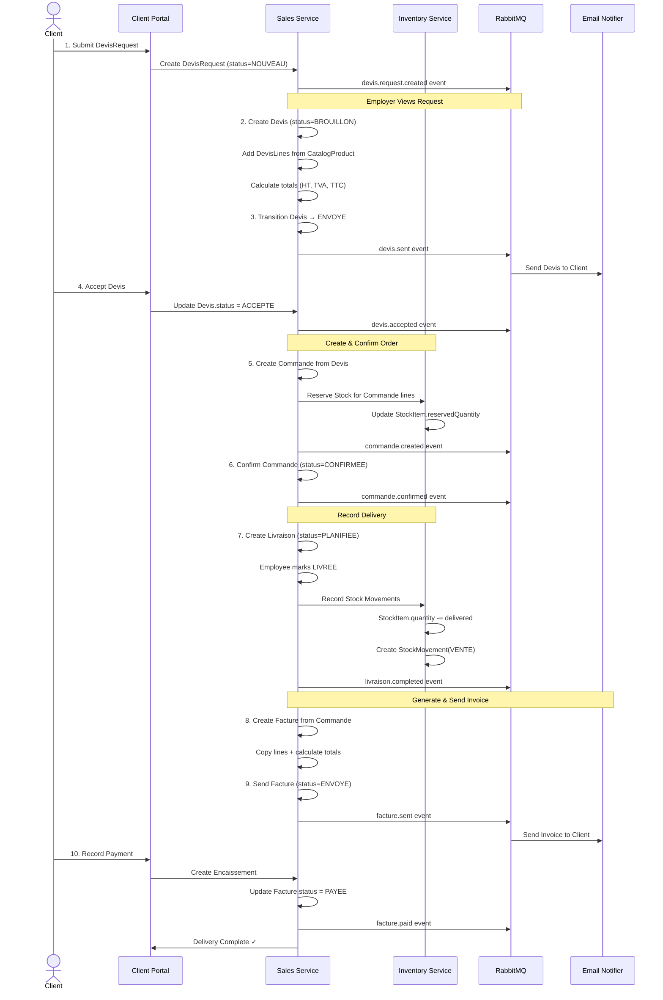
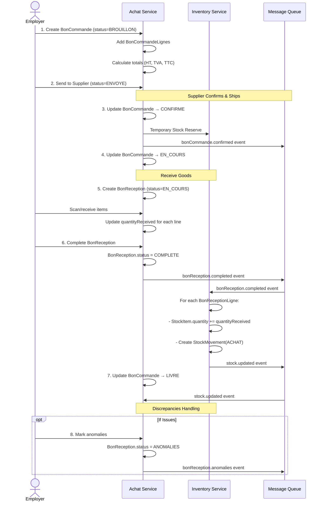
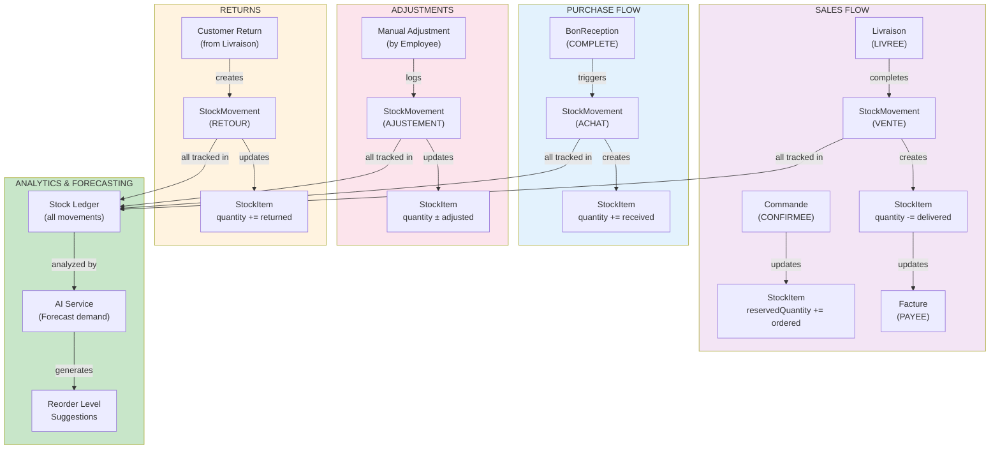
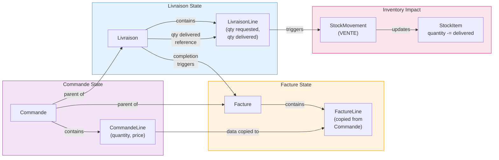
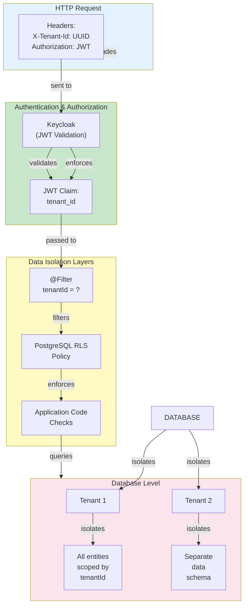
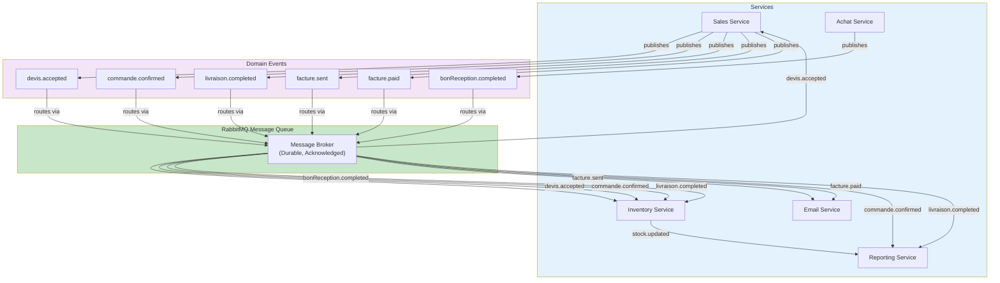
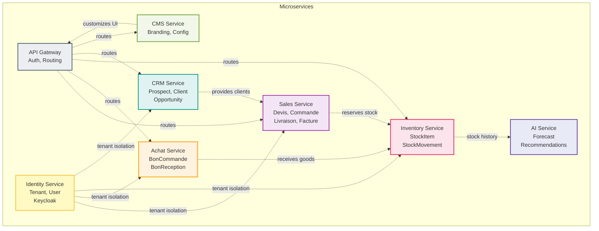

# System Interaction & Sequence Diagrams

## 1. Quote-to-Payment Workflow

---

## 2. Procurement Workflow

---

## 3. Inventory Stock Lifecycle

---

## 4. Data Flow: Commande → Livraison → Facture

---

## 5. Multi-Tenancy Enforcement

---

## 6. Event-Driven Architecture

---

## 7. Cross-Service Dependencies

