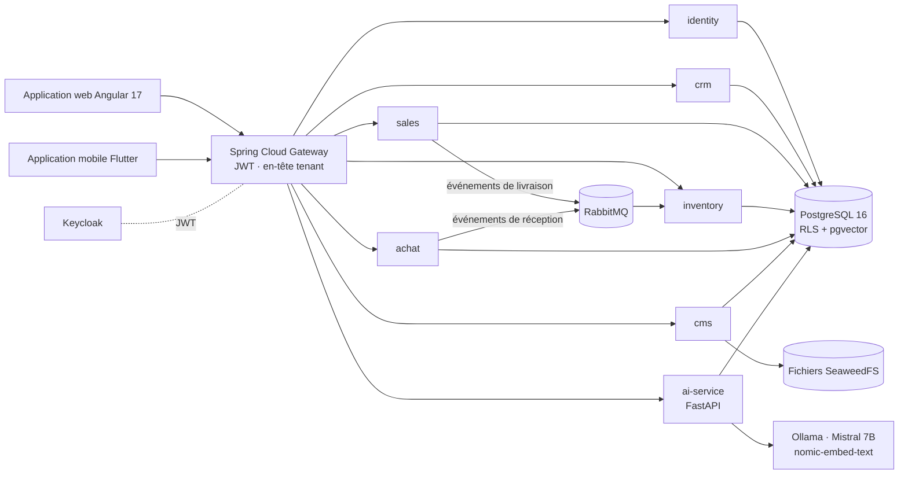

# 🏢 Plateforme ERP / CRM multi-tenant avec IA

> Un ERP/CRM SaaS pour les petites entreprises de fabrication, pensé autour des **ateliers de menuiserie aluminium**. Il gère tout le cycle commercial (prospect → devis → commande → livraison → facture → encaissement), les achats et le stock, un site public en marque blanche avec demande de devis en ligne, et un **module d'IA** pour les prix, les prévisions, les scores de risque et un assistant métier. Il est construit en **microservices Spring Boot**, avec une application web **Angular**, une application mobile **Flutter** et un service d'IA **FastAPI**, sur une pile 100 % libre et gratuite.

🇬🇧 [English version](README.md)


---

## 📌 Contexte

Les petits ateliers gèrent souvent leur activité avec des tableurs, des devis papier et des appels téléphoniques : les prix sont recalculés à la main pour chaque fenêtre ou porte, les ruptures de stock sont découvertes trop tard et les clients ne peuvent pas suivre leurs commandes. Cette plateforme donne à chaque entreprise (**tenant**) son propre espace isolé, avec :

- un **back-office** pour le gérant et les employés (CRM, ventes, achats, stock, tableaux de bord) ;
- un **portail client** et un **site public** aux couleurs de l'entreprise, où un visiteur peut demander un devis ;
- une **assistance IA** là où elle fait gagner du temps : prix suggéré pendant la rédaction d'un devis, alertes de rupture, scores d'acceptation des devis et de risque de paiement, et un assistant conversationnel qui répond à partir des documents de l'entreprise.

Le projet a été livré en **5 releases (23 user stories, 151 story points)**, détaillées dans le [rapport du projet](docs/PFA_REPORT.md).

## 👥 Rôles

| Rôle | Qui | Ce qu'il fait |
|---|---|---|
| `SUPER_ADMIN` | opérateur de la plateforme | crée les tenants, gère tous les utilisateurs, consulte le journal d'audit, entraîne les modèles d'IA |
| `EMPLOYER` | gérant de l'entreprise | pilote l'entreprise : ventes, achats, stock, identité visuelle, tableaux de bord, indicateurs IA |
| `EMPLOYEE` | employé | traite les opérations courantes selon ses droits |
| `CLIENT` | client | utilise le portail : demandes de devis, commandes, factures, fichiers |

## ✨ Fonctionnalités

### Cycle de vente
- **Devis** avec lignes, TVA et totaux, une **fenêtre de prix suggéré** alimentée par le service d'IA, et un cycle de vie strict :
  ```
  BROUILLON ──► ENVOYE ──► ACCEPTE   (une commande est créée automatiquement)
                     ├──► REFUSE
                     └──► ANNULE
  BROUILLON ───────────► ANNULE
  ```
- **Commandes → livraisons → factures → encaissements**, **génération PDF** des devis et factures (OpenPDF), **balance âgée** des factures, pièces jointes sur les devis.
- **Demandes de devis en ligne** depuis le site public ou le portail (coordonnées, type de projet et articles avec largeur × hauteur, série de profilé, vitrage, type d'ouverture et couleur), traitées dans une boîte dédiée avec notes et un cycle `NOUVEAU → EN_ETUDE → DEVIS_CREE` (ou `REFUSE`), puis rattachées au devis qui y répond.

### Achats et stock
- Fournisseurs, **bons de commande**, **bons de réception** ; la confirmation d'une réception alimente le stock.
- Produits, emplacements, historique des mouvements, ajustements manuels, **valorisation FIFO**.
- Le stock est mis à jour **de façon asynchrone** : les services ventes et achats publient des événements *livraison confirmée* / *réception confirmée* sur **RabbitMQ**, consommés par le service stock.

### CRM
- Prospects, clients et pipeline d'opportunités.

### CMS en marque blanche et site public
- **Identité visuelle** par tenant (logo, couleurs), fichiers stockés dans SeaweedFS, appliquée au back-office et aux pages publiques : accueil, à propos, services, galerie, contact.
- Administration des **données de référence** (listes de valeurs utilisées dans les formulaires).

### Tableaux de bord
- Tableaux de bord dédiés au super-administrateur, au gérant, aux employés et aux clients (indicateurs et graphiques ApexCharts).

### 🤖 Module d'IA (FastAPI)

| Fonction | Fonctionnement |
|---|---|
| **Prix suggéré** | formule explicable pour la menuiserie aluminium : surface (m²) × prix de base de la série de profilé (T45 → T80) × coefficient de vitrage (simple, double vitrage, feuilleté, argon…) × complexité × marge + coût fixe, avec un score de confiance |
| **Risque de rupture** | moyenne mobile exponentielle de la consommation → nombre de jours avant rupture et score de risque entre 0 et 1 |
| **Prévision des ventes et de la trésorerie** | modèle **Prophet** entraîné par tenant |
| **Acceptation des devis / risque de paiement** | classifieurs **XGBoost** entraînés par tenant sur l'historique des devis et des factures |
| **Anomalies de stock** | **Isolation Forest** sur les mouvements de stock |
| **Recommandations d'achat** | articles sous leur stock minimum, avec leur sortie moyenne par jour sur les 30 derniers jours |
| **Assistant métier (RAG)** | devis, factures et commandes indexés dans **pgvector** avec des embeddings `nomic-embed-text` (via Ollama), réponses par un **Mistral 7B** local ; conversations conservées par utilisateur et réponses à base de règles quand le LLM est indisponible |

- 40 endpoints REST, entraînement des modèles lancé depuis l'API (tâches de fond avec suivi d'état), modèles versionnés par tenant.
- Tout tourne **en local** (Ollama) : aucune donnée métier ne quitte l'infrastructure de l'entreprise.

### 📱 Application mobile (Flutter)
- Connexion (OAuth / Keycloak), tableau de bord, prospects, ventes, devis, achats, stock avec **scanner de codes-barres**, ajustements de stock, notifications, recherche globale et portail client.
- Stockage hors ligne avec **Drift**, gestion d'état avec **Riverpod**.

## 🧠 Architecture



| Service | Port | Rôle | Endpoints REST |
|---|---|---|---|
| gateway | 8443 | routage, validation JWT, propagation du tenant | — |
| identity | 8082 | utilisateurs, rôles, tenants, journal d'audit | 17 |
| crm | 8083 | prospects, clients, opportunités | 14 |
| sales | 8084 | devis, commandes, livraisons, factures, encaissements, demandes de devis, PDF | 46 |
| inventory | 8085 | produits, stock, mouvements | 8 |
| achat | 8086 | fournisseurs, bons de commande, réceptions | 16 |
| cms | 8087 | identité visuelle, site public, données de référence, fichiers | 24 |
| ai-service | 8000 | prix, prévisions, classification, anomalies, assistant RAG | 40 |
| Keycloak | 8180 | fournisseur d'identité | — |

## 🔐 Multi-tenant et sécurité

- Le **tenant** provient du claim `tenant_id` du JWT Keycloak ; la passerelle le transmet et chaque service le résout dans un filtre.
- Chaque connexion à la base est marquée avec `set_config('app.tenant_id', …)` et des politiques PostgreSQL de **Row-Level Security** (une trentaine, sur tous les schémas) filtrent chaque table : une erreur dans une requête ne peut pas exposer les données d'une autre entreprise. Un test d'intégration (`TenantIsolationIT`) vérifie cette isolation.
- Contrôle des rôles au niveau des méthodes (`@PreAuthorize`) et dans le service d'IA ; journal d'audit des actions sensibles.
- Observabilité : métriques Prometheus, tableaux de bord Grafana, logs dans Loki/Promtail, traces distribuées dans Zipkin.

Conception détaillée : [vue d'architecture](docs/diagrams/ARCHITECTURE_OVERVIEW.md), [diagramme de classes](docs/diagrams/CLASS_DIAGRAM.md), [diagrammes d'interaction](docs/diagrams/INTERACTION_DIAGRAMS.md), [cas d'utilisation](docs/diagrams/USECASE_DIAGRAM.md), [inventaire des API](docs/API_INVENTORY.md), [architecture IA](docs/AI_ARCHITECTURE.md).

## 🗓️ Releases

| Release | Contenu | Story points |
|---|---|---|
| R1 | Socle : authentification, multi-tenant, rôles, audit | 26 |
| R2 | Modules métier : CRM, ventes, stock, achats | 39 |
| R3 | Expérience client : portail, demande de devis en ligne, CMS en marque blanche | 18 |
| R4 | Module d'analyse IA | 37 |
| R5 | Application mobile et observabilité | 31 |

## 🚀 Démarrage

Prérequis : Docker Desktop, Node.js 20, (optionnel) Flutter 3.22.

```bash
git clone https://github.com/MohamedTrikii/PFA_CRM_ERP_Platform.git
cd PFA_CRM_ERP_Platform
cp .env.example .env          # puis définir vos propres mots de passe
```

**Windows (une seule commande) :**

```powershell
.\start.ps1            # lance Docker Compose, attend les health checks, démarre Angular
```

**Linux / macOS :**

```bash
./start.sh
```

Ouvrez ensuite **http://localhost:4200**. Des tenants et utilisateurs de démo peuvent être créés avec les scripts de [`scripts/`](scripts/SEED_README.md).

Application mobile :

```bash
cd mobile && flutter pub get && flutter run
```

## ✅ Tests et CI

| Partie | Ce qui est testé | Commande |
|---|---|---|
| Backend | tests unitaires (valorisation FIFO, stratégies de TVA, décorateur de relance, stock, réceptions) et tests d'intégration **Testcontainers** (cycle de vente, isolation des tenants, achats) | `cd backend && mvn test` |
| Service d'IA | tests de l'API (assistant, chat, entraînement, indexation, isolation des tenants) + lint | `cd ai-service && ruff check app/ && pytest` |
| Frontend | build de production | `cd frontend && npm run build` |

Le tout tourne dans **GitHub Actions** à chaque push sur `main`.

## 📁 Organisation du dépôt

```
backend/        microservices Spring Boot (Maven multi-modules) + noyau partagé (common)
frontend/       Angular 17 · Material · Tailwind · NgRx · ApexCharts
mobile/         Flutter · Riverpod · Drift (hors ligne) · OCR ML Kit
ai-service/     FastAPI · scikit-learn · XGBoost · Prophet · RAG pgvector
infra/          realm Keycloak, init Postgres, Prometheus, Grafana, Loki, RabbitMQ, données
docs/           rapport, architecture, diagrammes UML, inventaire des API, notes de développement
scripts/        génération de données, scripts SQL, tests rapides de l'IA
```

## ⚠️ Limites

- Sans Ollama, les embeddings passent à un vecteur déterministe issu d'un hachage : l'indexation continue de fonctionner, mais la recherche n'est plus sémantique.
- Le prix suggéré reste une formule explicable à base de règles, tant que l'historique des devis ne suffit pas à entraîner un modèle.

## 👥 Auteurs

- **Mohamed Triki** — [GitHub](https://github.com/MohamedTrikii)
- Ibrahim — architecture et documentation UML
