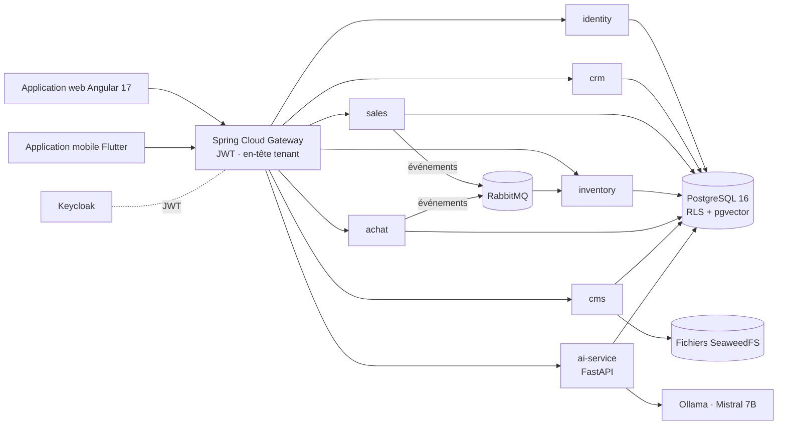

# 🏢 Plateforme ERP / CRM multi-tenant avec IA

> Un ERP/CRM SaaS composé de **microservices Spring Boot**, d'une application web **Angular**, d'une application mobile **Flutter** et d'un service d'IA **FastAPI** : ventes, achats, stock, CRM, portail client, CMS en marque blanche et assistance IA, sur une pile **100 % libre et gratuite**.

🇬🇧 [English version](README.md)


---

## ✨ Fonctionnalités

**Modules métier**
- **CRM** : prospects, clients, pipeline d'opportunités.
- **Ventes** : devis → commandes → livraisons → factures → encaissements, génération PDF, pièces jointes de devis, balance âgée.
- **Achats** : fournisseurs, bons de commande, bons de réception, stratégies de calcul de TVA.
- **Stock** : produits, emplacements, mouvements, valorisation FIFO, mis à jour **de façon asynchrone** par les événements de livraison et de réception (RabbitMQ).
- **Portail client** : demandes de devis publiques, suivi des commandes et des factures.
- **CMS en marque blanche** : identité visuelle par tenant (logo, couleurs), pages publiques (accueil, à propos, services, galerie, contact), administration des données de référence.

**Service d'IA (FastAPI)**
- **Suggestion de prix** pour les devis, **prévision des ventes** (Prophet), **prédiction d'acceptation des devis** (XGBoost), **détection d'anomalies**.
- **Assistant RAG** : documents métier indexés dans **pgvector**, réponses par un LLM local (**Ollama / Mistral 7B**) avec solution de repli si le modèle est indisponible ; conversations enregistrées par utilisateur.
- Entraînement des modèles déclenché depuis l'API, suivi par tenant.

**Plateforme**
- **Multi-tenant** avec **Row-Level Security** PostgreSQL et résolution du tenant dans la passerelle et dans chaque service.
- **Keycloak** SSO / JWT avec les rôles `SUPER_ADMIN`, `EMPLOYER`, `EMPLOYEE`, `CLIENT` ; sécurité au niveau des méthodes.
- **Observabilité** : Prometheus, Grafana, Loki/Promtail, traçage Zipkin.
- **Qualité** : JUnit + Testcontainers, tests de charge Gatling, configuration SonarQube, CI GitHub Actions.

## 🧠 Architecture



| Service | Port | Rôle |
|---|---|---|
| gateway | 8443 | routage, validation JWT, propagation du tenant |
| identity | 8082 | utilisateurs, rôles, tenants, journal d'audit |
| crm | 8083 | prospects, clients, opportunités |
| sales | 8084 | devis, commandes, livraisons, factures, encaissements |
| inventory | 8085 | produits, stock, mouvements |
| achat | 8086 | fournisseurs, bons de commande, réceptions |
| cms | 8087 | identité visuelle, site public, données de référence |
| ai-service | 8000 | prix, prévisions, classification, assistant RAG |
| Keycloak | 8180 | fournisseur d'identité |

Documentation détaillée : [vue d'architecture](docs/diagrams/ARCHITECTURE_OVERVIEW.md), [diagramme de classes](docs/diagrams/CLASS_DIAGRAM.md), [diagrammes d'interaction](docs/diagrams/INTERACTION_DIAGRAMS.md), [cas d'utilisation](docs/diagrams/USECASE_DIAGRAM.md), [inventaire des API](docs/API_INVENTORY.md), [architecture IA](docs/AI_ARCHITECTURE.md), [rapport du projet](docs/PFA_REPORT.md).

## 🚀 Démarrage

Prérequis : Docker Desktop, Node.js 20, (optionnel) Flutter 3.22.

```bash
git clone https://github.com/MohamedTrikii/PFA_CRM_ERP_Platform.git
cd PFA_CRM_ERP_Platform
cp .env.example .env          # puis définir vos propres mots de passe
```

**Windows (une seule commande) :**

```powershell
.\start.ps1            # lance Docker Compose, attend les health checks, démarre Angular
```

**Linux / macOS :**

```bash
./start.sh
```

Ouvrez ensuite **http://localhost:4200**. Des tenants et utilisateurs de démo peuvent être créés avec les scripts de [`scripts/`](scripts/SEED_README.md).

Application mobile :

```bash
cd mobile && flutter pub get && flutter run
```

## ✅ Tests

```bash
cd backend && mvn test                       # tests unitaires + intégration Testcontainers (Docker requis)
cd frontend && npm run build                 # build de production
cd ai-service && ruff check app/ && pytest   # lint + tests de l'API
```

## 📁 Organisation du dépôt

```
backend/        microservices Spring Boot (Maven multi-modules) + noyau partagé (common)
frontend/       Angular 17 · Material · Tailwind · NgRx
mobile/         Flutter · Riverpod · Drift (hors ligne) · OCR ML Kit
ai-service/     FastAPI · scikit-learn · XGBoost · Prophet · RAG pgvector
infra/          realm Keycloak, init Postgres, Prometheus, Grafana, Loki, RabbitMQ, données
performance/    tests de charge Gatling
docs/           architecture, diagrammes UML, inventaire des API, rapport, notes de développement
scripts/        génération de données, scripts SQL, tests rapides de l'IA
```

## 👥 Auteurs

- **Mohamed Triki** — [GitHub](https://github.com/MohamedTrikii)
- Ibrahim — architecture et documentation UML
