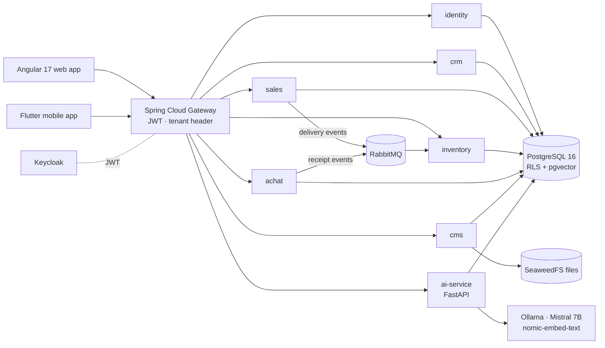

# 🏢 Multi-Tenant ERP / CRM Platform with AI

> A SaaS ERP/CRM for small manufacturing businesses — designed around **aluminium joinery workshops** — that runs the whole commercial cycle (prospect → quote → order → delivery → invoice → payment), purchasing and stock, a white-label public website with an online quote request, and an **AI module** for pricing, forecasting, risk scoring and a business assistant. Built as **Spring Boot microservices**, an **Angular** web app, a **Flutter** mobile app and a **FastAPI** AI service, on a 100 % free & open-source stack.

🇫🇷 [Version française](README.fr.md)


---

## 📌 Context

Small workshops usually run their business with spreadsheets, paper quotes and phone calls: prices are recomputed by hand for every window or door, stock-outs are discovered too late and customers cannot follow their orders. This platform gives each company (**tenant**) its own isolated space with:

- a **back-office** for the owner and employees (CRM, sales, purchasing, stock, dashboards);
- a **customer portal** and a **public website** in the company's colours, where a visitor can request a quote;
- **AI assistance** where it saves time: a suggested price while drafting a quote, stock-out warnings, quote-acceptance and payment-risk scores, and a chat assistant that answers questions about the company's own documents.

The project was delivered in **5 releases (23 user stories, 151 story points)**, documented in the [project report](docs/PFA_REPORT.md).

## 👥 Roles

| Role | Who | What they do |
|---|---|---|
| `SUPER_ADMIN` | platform operator | creates tenants, manages all users, sees the audit log, trains AI models |
| `EMPLOYER` | company owner / manager | runs the company: sales, purchasing, stock, branding, dashboards, AI insights |
| `EMPLOYEE` | staff member | handles day-to-day operations within the permissions given |
| `CLIENT` | customer | uses the portal: quote requests, orders, invoices, uploaded files |

## ✨ Features

### Sales cycle
- **Quotes (devis)** with lines, VAT and totals, a **price-suggestion dialog** powered by the AI service, and a strict status machine:
  ```
  BROUILLON ──► ENVOYE ──► ACCEPTE   (an order is created automatically)
                     ├──► REFUSE
                     └──► ANNULE
  BROUILLON ───────────► ANNULE
  ```
- **Orders → deliveries → invoices → payments** (encaissements), invoice **PDF generation** (OpenPDF), **invoice aging** report, attachments on quotes.
- **Online quote requests** from the public website or the portal (contact details, project type and items with width × height, profile series, glass, opening type and colour), handled in a dedicated inbox with notes and a status flow `NOUVEAU → EN_ETUDE → DEVIS_CREE` (or `REFUSE`), then linked to the quote that answers them.

### Purchasing & stock
- Suppliers, **purchase orders**, **goods receipts**; confirming a receipt adds the stock.
- Products, stock locations, movement history, manual adjustments, **FIFO valuation**.
- Stock is updated **asynchronously**: the sales and purchasing services publish *delivery confirmed* / *receipt confirmed* events on **RabbitMQ**, consumed by the inventory service.

### CRM
- Prospects, clients and opportunities pipeline.

### White-label CMS & public website
- Per-tenant **branding** (logo, colours) stored with files on SeaweedFS, applied to the back-office and to the public pages: home, about, services, gallery, contact.
- **Reference data** administration (lists of values used in forms).

### Dashboards
- Dedicated dashboards for the super-admin, the employer, employees and clients (KPIs and charts with ApexCharts).

### 🤖 AI module (FastAPI)

| Feature | How it works |
|---|---|
| **Price suggestion** | explainable formula for aluminium joinery: area (m²) × base rate of the profile series (T45 → T80) × glass factor (single, double glazing, laminated, argon…) × complexity × margin + fixed cost, returned with a confidence score |
| **Stock-out risk** | exponential moving average of consumption → estimated days before stock-out and a 0–1 risk score |
| **Sales & cash-flow forecast** | **Prophet** model trained per tenant |
| **Quote acceptance / payment risk** | **XGBoost** classifiers trained per tenant on quote and invoice history |
| **Stock anomalies** | **Isolation Forest** on stock movements |
| **Purchase recommendations** | lists items below their minimum stock, with their average daily outflow over the last 30 days |
| **Business assistant (RAG)** | quotes, invoices and orders are indexed in **pgvector** with `nomic-embed-text` embeddings (via Ollama), and answered by a local **Mistral 7B**; conversations are kept per user and a rule-based fallback answers when the LLM is offline |

- 40 REST endpoints, model training launched from the API (background tasks with status tracking), models versioned per tenant.
- Everything runs **locally** (Ollama): no business data leaves the company's infrastructure.

### 📱 Mobile app (Flutter)
- Login (OAuth / Keycloak), dashboard, prospects, sales, quotes, purchases, inventory with **barcode scanner**, stock adjustments, notifications, global search and the client portal.
- Offline-first storage with **Drift**, state management with **Riverpod**.

## 🧠 Architecture



| Service | Port | Responsibility | REST endpoints |
|---|---|---|---|
| gateway | 8443 | routing, JWT validation, tenant propagation | — |
| identity | 8082 | users, roles, tenants, audit log | 17 |
| crm | 8083 | prospects, clients, opportunities | 14 |
| sales | 8084 | quotes, orders, deliveries, invoices, payments, quote requests, PDF | 46 |
| inventory | 8085 | products, stock, movements | 8 |
| achat | 8086 | suppliers, purchase orders, receipts | 16 |
| cms | 8087 | branding, public site, reference data, files | 24 |
| ai-service | 8000 | pricing, forecasting, classification, anomalies, RAG assistant | 40 |
| Keycloak | 8180 | identity provider | — |

## 🔐 Multi-tenancy & security

- The **tenant** comes from the `tenant_id` claim of the Keycloak JWT; the gateway forwards it and every service resolves it in a filter.
- Each database connection is stamped with `set_config('app.tenant_id', …)` and PostgreSQL **Row-Level Security** policies (about 30, across all schemas) filter every table — a bug in a query cannot leak another company's data. An integration test (`TenantIsolationIT`) checks this isolation.
- Role checks at method level (`@PreAuthorize`) and in the AI service; audit log of sensitive actions.
- Observability: Prometheus metrics, Grafana dashboards, logs in Loki/Promtail, distributed traces in Zipkin.

Detailed design: [architecture overview](docs/diagrams/ARCHITECTURE_OVERVIEW.md), [class diagram](docs/diagrams/CLASS_DIAGRAM.md), [interaction diagrams](docs/diagrams/INTERACTION_DIAGRAMS.md), [use cases](docs/diagrams/USECASE_DIAGRAM.md), [API inventory](docs/API_INVENTORY.md), [AI architecture](docs/AI_ARCHITECTURE.md).

## 🗓️ Releases

| Release | Scope | Story points |
|---|---|---|
| R1 | Platform foundation: authentication, tenancy, RBAC, audit | 26 |
| R2 | Core business modules: CRM, sales, inventory, purchasing | 39 |
| R3 | Customer experience: portal, online quote request, white-label CMS | 18 |
| R4 | AI analytical module | 37 |
| R5 | Mobile app and observability | 31 |

## 🚀 Getting started

Prerequisites: Docker Desktop, Node.js 20, (optional) Flutter 3.22.

```bash
git clone https://github.com/MohamedTrikii/PFA_CRM_ERP_Platform.git
cd PFA_CRM_ERP_Platform
cp .env.example .env          # then set your own passwords
```

**Windows (one command):**

```powershell
.\start.ps1            # starts Docker Compose, waits for health checks, launches Angular
```

**Linux / macOS:**

```bash
./start.sh
```

Then open **http://localhost:4200**. Demo tenants and users can be seeded with the scripts in [`scripts/`](scripts/SEED_README.md).

Mobile app:

```bash
cd mobile && flutter pub get && flutter run
```

## ✅ Tests & CI

| Part | What is tested | Command |
|---|---|---|
| Backend | unit tests (FIFO valuation, VAT strategies, retry decorator, stock, receipts) and integration tests with **Testcontainers** (sales flow, tenant isolation, purchasing) | `cd backend && mvn test` |
| AI service | API tests (assistant, chat, training, indexing, tenant isolation) + lint | `cd ai-service && ruff check app/ && pytest` |
| Frontend | production build | `cd frontend && npm run build` |

All of it runs in **GitHub Actions** on every push to `main`.

## 📁 Repository layout

```
backend/        Spring Boot microservices (Maven multi-module) + shared kernel (common)
frontend/       Angular 17 · Material · Tailwind · NgRx · ApexCharts
mobile/         Flutter · Riverpod · Drift (offline) · ML Kit OCR
ai-service/     FastAPI · scikit-learn · XGBoost · Prophet · pgvector RAG
infra/          Keycloak realm, Postgres init, Prometheus, Grafana, Loki, RabbitMQ, seeds
docs/           report, architecture, UML diagrams, API inventory, development notes
scripts/        data seeding, SQL helpers, AI smoke tests
```

## ⚠️ Limitations

- Without Ollama, embeddings fall back to a deterministic hash vector: indexing keeps working, but search is no longer semantic.
- Price suggestion is an explainable rule-based formula until enough quote history exists to train a model.

## 👥 Authors

- **Mohamed Triki** — [GitHub](https://github.com/MohamedTrikii)
- Ibrahim — architecture & UML documentation
