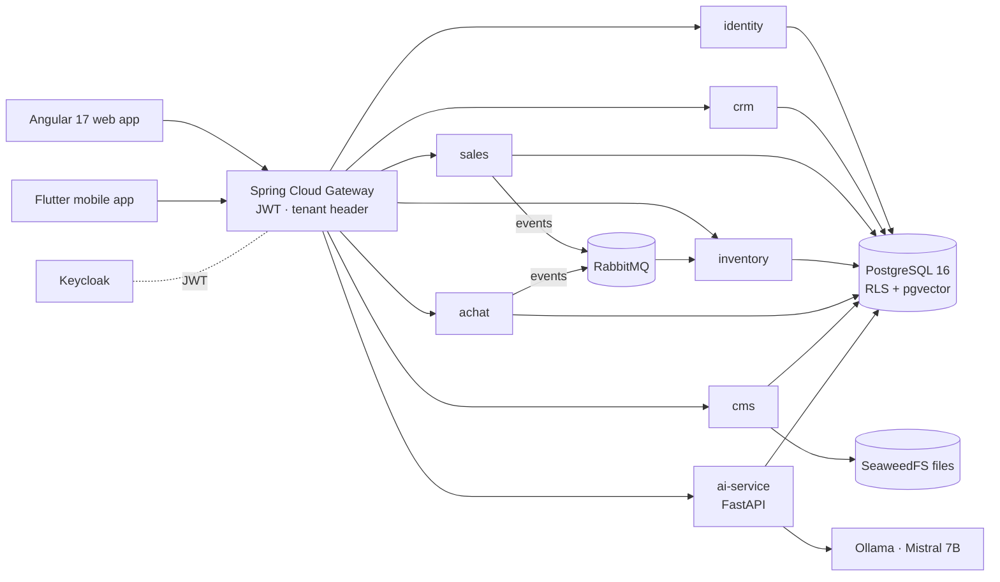

# 🏢 Multi-Tenant ERP / CRM Platform with AI

> A SaaS ERP/CRM built as **Spring Boot microservices**, an **Angular** web app, a **Flutter** mobile app and a **FastAPI** AI service — sales, purchasing, inventory, CRM, customer portal, white-label CMS and AI assistance, on a **100 % free & open-source** stack.

🇫🇷 [Version française](README.fr.md)


---

## ✨ Features

**Business modules**
- **CRM** — prospects, clients, opportunities pipeline.
- **Sales** — quotes → orders → deliveries → invoices → payments, PDF generation, quote attachments, invoice aging.
- **Purchasing** — suppliers, purchase orders, goods receipts, VAT calculation strategies.
- **Inventory** — products, stock locations, movements, FIFO valuation; updated **asynchronously** from delivery / receipt events (RabbitMQ).
- **Customer portal** — public quote requests, order and invoice tracking.
- **White-label CMS** — per-tenant branding (logo, colours), public pages (home, about, services, gallery, contact), reference-data admin.

**AI service (FastAPI)**
- **Price suggestion** for quotes, **sales forecasting** (Prophet), **quote-acceptance prediction** (XGBoost), **anomaly detection**.
- **RAG assistant**: business documents indexed in **pgvector**, answered by a local LLM (**Ollama / Mistral 7B**), with a fallback when the model is unavailable; conversations stored per user.
- Model training triggered from the API, tracked per tenant.

**Platform**
- **Multi-tenancy** with PostgreSQL **Row-Level Security** and tenant resolution at the gateway and in every service.
- **Keycloak** SSO / JWT with roles `SUPER_ADMIN`, `EMPLOYER`, `EMPLOYEE`, `CLIENT`; method-level security.
- **Observability** — Prometheus, Grafana, Loki/Promtail, Zipkin tracing.
- **Quality** — JUnit + Testcontainers, Gatling load tests, SonarQube configuration, GitHub Actions CI.

## 🧠 Architecture



| Service | Port | Responsibility |
|---|---|---|
| gateway | 8443 | routing, JWT validation, tenant propagation |
| identity | 8082 | users, roles, tenants, audit log |
| crm | 8083 | prospects, clients, opportunities |
| sales | 8084 | quotes, orders, deliveries, invoices, payments |
| inventory | 8085 | products, stock, movements |
| achat | 8086 | suppliers, purchase orders, receipts |
| cms | 8087 | branding, public site, reference data |
| ai-service | 8000 | pricing, forecasting, classification, RAG assistant |
| Keycloak | 8180 | identity provider |

Detailed docs: [architecture overview](docs/diagrams/ARCHITECTURE_OVERVIEW.md), [class diagram](docs/diagrams/CLASS_DIAGRAM.md), [interaction diagrams](docs/diagrams/INTERACTION_DIAGRAMS.md), [use cases](docs/diagrams/USECASE_DIAGRAM.md), [API inventory](docs/API_INVENTORY.md), [AI architecture](docs/AI_ARCHITECTURE.md), [project report](docs/PFA_REPORT.md).

## 🚀 Getting started

Prerequisites: Docker Desktop, Node.js 20, (optional) Flutter 3.22.

```bash
git clone https://github.com/MohamedTrikii/PFA_CRM_ERP_Platform.git
cd PFA_CRM_ERP_Platform
cp .env.example .env          # then set your own passwords
```

**Windows (one command):**

```powershell
.\start.ps1            # starts Docker Compose, waits for health checks, launches Angular
```

**Linux / macOS:**

```bash
./start.sh
```

Then open **http://localhost:4200**. Demo tenants and users can be seeded with the scripts in [`scripts/`](scripts/SEED_README.md).

Mobile app:

```bash
cd mobile && flutter pub get && flutter run
```

## ✅ Tests

```bash
cd backend && mvn test                       # unit + Testcontainers integration tests (Docker required)
cd frontend && npm run build                 # production build
cd ai-service && ruff check app/ && pytest   # lint + API tests
```

## 📁 Repository layout

```
backend/        Spring Boot microservices (Maven multi-module) + shared kernel (common)
frontend/       Angular 17 · Material · Tailwind · NgRx
mobile/         Flutter · Riverpod · Drift (offline) · ML Kit OCR
ai-service/     FastAPI · scikit-learn · XGBoost · Prophet · pgvector RAG
infra/          Keycloak realm, Postgres init, Prometheus, Grafana, Loki, RabbitMQ, seeds
performance/    Gatling load tests
docs/           architecture, UML diagrams, API inventory, report, development notes
scripts/        data seeding, SQL helpers, AI smoke tests
```

## 👥 Authors

- **Mohamed Triki** — [GitHub](https://github.com/MohamedTrikii)
- Ibrahim — architecture & UML documentation
