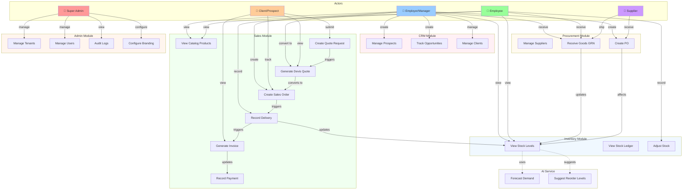

# Use-Case Diagram: CRM/ERP Platform



## Use Cases by Module

### **CRM Module**
| Use Case | Description | Primary Actor |
|----------|-------------|----------------|
| **Manage Prospects** | Create, qualify, and convert prospects to clients | Employer |
| **Track Opportunities** | Monitor sales opportunities through pipeline | Employer |
| **Manage Clients** | Maintain client information and relationships | Employer |

### **Sales Module** (Main Revenue Workflow)
| Use Case | Description | Primary Actor |
|----------|-------------|----------------|
| **View Catalog Products** | Browse available products for quoting | Employee/Employer |
| **Create Quote Request** | Client submits quote request via portal | Client |
| **Generate Devis Quote** | Convert request to formal quote | Employer |
| **Create Sales Order** | Accept quote and create binding order | Employer |
| **Record Delivery** | Ship goods and update inventory | Employee |
| **Generate Invoice** | Create billing document from order | Employer |
| **Record Payment** | Log customer payments received | Employee |

### **Procurement Module**
| Use Case | Description | Primary Actor |
|----------|-------------|----------------|
| **Manage Suppliers** | Maintain supplier information | Employer |
| **Create PO** | Generate purchase order for supplier | Employer |
| **Receive Goods GRN** | Record goods receipt and update stock | Employee |

### **Inventory Module**
| Use Case | Description | Primary Actor |
|----------|-------------|----------------|
| **View Stock Levels** | Monitor available stock by location | Employee/Employer |
| **View Stock Ledger** | Track all stock movements with audit trail | Employee |
| **Adjust Stock** | Make manual inventory adjustments | Employee |

### **Admin Module**
| Use Case | Description | Primary Actor |
|----------|-------------|----------------|
| **Manage Tenants** | Create and configure tenant organizations | Super Admin |
| **Manage Users** | Add/remove users and assign roles | Super Admin |
| **Audit Logs** | Monitor system activities and changes | Super Admin |
| **Configure Branding** | Customize tenant UI appearance | Super Admin |

### **AI Service**
| Use Case | Description | Primary Actor |
|----------|-------------|----------------|
| **Forecast Demand** | Predict future product demand | System |
| **Suggest Reorder Levels** | Recommend when to reorder stock | System |

---

## Key Workflows

### **UC5 → UC10: Quote-to-Payment Workflow**
```
1. Client submits quote request (DevisRequest)
   ↓
2. Employer converts to Devis quote
   ↓
3. Client accepts → creates Commande (sales order)
   ↓
4. Employee records Livraison (delivery)
   ↓
5. System generates Facture (invoice)
   ↓
6. Client records payment via portal
```

### **UC12 → UC13: Procurement Workflow**
```
1. Employer creates BonCommande (PO) to supplier
   ↓
2. Supplier ships goods
   ↓
3. Employee creates BonReception (goods receipt)
   ↓
4. Stock automatically updated
```

### **UC14 Integration**
- Stock is reserved when Commande is confirmed
- Stock is updated when Livraison is completed
- Stock is updated when BonReception is completed
- AI service uses stock history to forecast demand

