<a name="chapter-7"></a>
| US-22 | As an EMPLOYER, I want distributed request traces across all microservices | Must | 5 | R5 |
| US-23 | As an EMPLOYER, I want a CI pipeline that catches regressions before merging | Must | 5 | R5 |

**Total: 151 story points across 23 user stories.**

### 2.3.4 Releases Overview

| Release | Title | User Stories | Total SP | Status |
|---|---|---|---|---|
| **R1** | Platform Foundation (Auth, Tenancy, RBAC, Audit) | US-01 to US-04 | 26 SP | ✅ Done |
| **R2** | Core Business Modules (CRM, Sales, Inventory, Achats) | US-05 to US-09 | 39 SP | ✅ Done |
| **R3** | Customer Experience and White-Label CMS | US-10 to US-13 | 18 SP | ✅ Done |
| **R4** | AI Analytical Module | US-14 to US-17 | 37 SP | ✅ Done |
| **R5** | Mobile App and Observability | US-18 to US-23 | 31 SP | ✅ Done |

---

<a name="chapter-3"></a>
# Chapter 3 – Release 1: Platform Foundation

**Sprint Goal:** Login works; every request is tenant-scoped; cross-tenant access is blocked; RBAC is enforced; all sensitive mutations are audited in a tamper-proof hash chain.

## 3.1 System Boundary and Actors

**System:** ERP Platform — Identity Service (port 8082) + Spring Cloud Gateway (port 8443) + Angular Frontend

**Primary Actors:**

# Chapter 6 – Release 4: AI Analytical Module

**Sprint Goal:** Make AI-driven assistance available to users: price suggestions, inventory risk insights, conversational assistance, and semantic retrieval for devis documents. The AI module is delivered as an isolated service with strict tenant and role isolation.

## 6.1 AI Module Architecture

The AI functionality is implemented as a standalone microservice (the ai-service) that exposes secured HTTP endpoints for price suggestion, stock forecasting, conversational assistance, document indexing and retrieval, and model management. The service integrates with the platform's identity provider for JWT validation and uses the project's PostgreSQL instance for persistent storage of retrieval documents and model metadata. This separation allows the AI module to evolve independently while maintaining the same security and tenancy guarantees as the rest of the platform.

## 6.2 AI Features and Models (Overview)

This release provides a pragmatic set of AI features designed to operate with the available ERP data and respect tenant isolation and confidentiality. The descriptions below include the actual algorithms, formulas and fallback logic used in the service.

6.2.1 Price suggestion
- Purpose: offer an interpretable suggested unit price for an aluminum joinery item to assist sales users while drafting a devis.
- Algorithm: a calibrated, rule-based formula computes suggested price from product area, complexity, and margin.
- Formula:
  ```text
  area_m2 = (width_mm / 1000) * (height_mm / 1000)
  base_price = base_rate_tnd_per_m2 * area_m2
  complexity_multiplier = 1 + complexity_pct
  suggested_price_ht = base_price * complexity_multiplier * (1 + margin_pct) + fixed_cost
  suggested_unit_price = suggested_price_ht / quantity
  ```
- Notes: when tenant history is limited, this explainable formula is used instead of a learned predictor and the service returns a confidence score based on record volume.

6.2.2 Inventory risk forecasting
- Purpose: surface potential stock shortages and prioritise items requiring attention.
- Algorithm: an exponential moving average (EMA) of recent consumption is computed, then compared to current stock to estimate depletion days and a logistic risk score.
- Formula:
  ```text
  ema_t = alpha * consumption_t + (1 - alpha) * ema_{t-1}
  days_to_stockout = current_quantity / max(ema_last, 1)
  risk_score = 1 / (1 + exp(0.15 * (days_to_stockout - threshold_days)))
  ```
- Risk categories:
  - CRITICAL: `risk_score > 0.8`
  - HIGH: `0.6 < risk_score <= 0.8`
  - MEDIUM: `0.4 < risk_score <= 0.6`
  - LOW: otherwise

6.2.3 Sales forecasting
- Purpose: provide medium-term revenue forecasts to support planning and dashboards.
- Algorithm: a time-series model decomposes sales into trend and seasonality, with a Ridge regression fallback for short histories.
- Formula:
  ```text
  y_t = trend_t + seasonality_t + error_t
  trend_t = k * t + m
  seasonality_t = A_7 * sin(2π t / 7) + B_7 * cos(2π t / 7)
                 + A_30 * sin(2π t / 30) + B_30 * cos(2π t / 30)
  y_hat = trend_t + seasonality_t
  ```
- Notes: confidence intervals are derived from residual variance when available.

6.2.4 Quote acceptance prediction
- Purpose: estimate the likelihood that a submitted quote will be accepted by a customer.
- Algorithm: a gradient-boosted classifier scores quotes using sales and product attributes.
- Score:
  ```text
  x = [total_ttc, discount_pct, client_segment, line_count, margin_pct, valid_days]
  probability = sigmoid(f(x))
  ```
  where `f(x)` is the ensemble output from XGBoost.
- Notes: the service converts probability into labels such as `likely`, `possible`, and `unlikely`.

6.2.5 Payment risk scoring and anomaly detection
- Purpose: assess invoice payment risk and detect anomalous stock movements.
- Algorithms: payment risk uses tree-based scoring while anomaly detection uses Isolation Forest.
- Payment risk:
  ```text
  payment_features = [total_ttc, payment_ratio, days_to_due, client_risk_segment]
  payment_risk = sigmoid(g(x))
  ```
- Isolation Forest anomaly score:
  ```text
  score = 2^{-E(h(x)) / c(n)}
  anomaly = score < threshold
  ```
  where `E(h(x))` is the average path length of sample `x` and `c(n)` is the normalization constant for sample size.
- Notes: anomalous movements are surfaced when `pred == -1` and ranked by decreasing anomaly severity.

6.2.6 Conversational assistant
- Purpose: provide an interactive assistant that can answer questions, summarize context, and help with ERP workflows.
- Algorithm: a locally hosted Mistral 7B model receives a context-augmented prompt and returns text completions.
- Prompt pattern:
  ```text
  [ERP Context]
  {context}

  [Question]
  {message}
  ```
- Notes: no fine-tuning is performed; domain relevance is achieved by injecting tenant-specific context and documented retrieval results.

6.2.7 Document retrieval (RAG)
- Purpose: enable semantic search over devis and related documents and support the conversational assistant with relevant context.
- Algorithm: text is converted to 256-dimensional embeddings and nearest neighbors are selected using vector distance.
- Formula:
  ```text
  distance = ||v_query - v_doc||_2
  similarity = 1 / (1 + distance)
  ```
- Notes: tenant isolation is enforced by storing embeddings and documents with tenant identifiers and by applying PostgreSQL RLS during retrieval.

## 6.3 Dataset

The AI module consumes both internal ERP records and curated external datasets used for prototyping and initial validation. Internal sources include accepted devis, invoices, catalog entries and stock movement logs. External datasets were adapted and normalized to align with the project's schema, providing additional coverage where tenant history is insufficient for training. Demo tenants are seeded with a small set of catalog products and synthetic records to enable end-to-end verification without relying on production data.

Key constraints and mitigations:
- Many tenants start with limited historical records; the module therefore uses hybrid strategies that prefer explainable rules when data are sparse and apply learned models when sufficient examples exist.
- Tenant data never cross boundaries: all persisted AI artifacts (documents, embeddings, model metadata) are stored with tenant identifiers and are subject to the platform's row-level security controls.

## 6.4 Methodology

The AI workstream follows an industry-standard data science lifecycle adapted to the project's agile cadence. The phases include business understanding, data understanding, data preparation, modeling, evaluation and deployment. Practical adaptations for this project include short feedback loops with domain experts, conservative use of ML where data are limited, and strong emphasis on interpretability and operational safety.

Evaluation practices emphasize user-centric validation: model outputs are assessed for usefulness in workflows (for example, whether a price suggestion aids a salesperson), and detection thresholds are tuned to balance noise versus missed signals. Wherever possible, the service surfaces explanations and confidence indicators so that human operators can make informed decisions.

## 6.5 Use Cases and Consumer Flows

Primary user-facing use cases in Release 4:
- Request a price suggestion while composing a devis.
- View inventory risk summaries and receive prioritized alerts for potential stock-outs.
- Consult the conversational assistant for context-aware help and summarization of tenant data.
- Index and semantically search devis documents to retrieve precedent examples during quoting.
- Surface quote acceptance probabilities and payment risk signals on sales dashboards to aid prioritization and collections.

The AI outputs are designed to be consumed by the Angular and mobile frontends, the role-aware dashboards, and administrative tools. Access control is enforced at the service level so that only authorized roles can call sensitive endpoints.

## 6.6 Data Model and Operational Notes

Primary AI-related entities and their role in the system:
- AiDocument: stores tenant-scoped document content and metadata used for semantic retrieval.
- AiEmbedding: stores the vector representation associated with an AiDocument together with model provenance and tenant information.
- Model registry entries: capture model name, version, artifact location and training metadata to enable reproducible deployments and rollbacks.
- Forecast and score records: transient API responses and cached summaries intended for dashboard display and notification aggregation.

Operational considerations:
- Models are versioned and can be retired or updated independently of the service runtime.
- The AI service is intentionally independent from the Java backend to enable rapid iteration and separate scaling.
- All production-level calls are authenticated and authorized using the platform's identity provider; tenant context is set before any data access to enforce isolation.

This chapter describes the Release 4 scope and design philosophy for the AI Analytical Module, with emphasis on safe, explainable assistance and a clear migration path from rule-based prototypes to data-driven models as tenant data maturity grows.

<a name="chapter-7"></a>
## 7.1 Mobile Application (Flutter)

---

### UC_USERS – Manage Users

| Field | Content |
|---|---|
| **Name** | Manage Users |
| **Actors** | EMPLOYER or SUPER_ADMIN (primary), Keycloak Admin API (secondary) |
| **Preconditions** | <<include>> Authenticate via SSO; requester has `EMPLOYER` or `SUPER_ADMIN` role |
| **Postconditions** | User is created/updated/deactivated in tenant scope; Keycloak account created/updated; `CREATE_USER` or `DEACTIVATE_USER` audit entry written |
| **Main Flow** | 1. EMPLOYER navigates to User Management. 2. System fetches users filtered by current `tenant_id` (Hibernate filter + RLS). 3. EMPLOYER fills create form: `email`, `role`, `employeeFunction` (required if role = EMPLOYEE). 4. `UserService.create()` calls `TenantContext.requireTenant()`, checks email uniqueness in tenant. 5. User entity persisted. 6. Keycloak Admin REST API: `POST /admin/realms/erp/users` creates identity. 7. `@Auditable` appends `CREATE_USER` to audit chain. |
| **<<include>> UC_FUNC — Assign Employee Function** | When `role = EMPLOYEE`, the `employeeFunction` field (SALES / WAREHOUSE / BUYER / ACCOUNTANT / SUPPORT / MANAGER) is required and validated before persistence. |
| **Alternative Flow A — Email already exists** | A1. `UserRepository.existsByEmailAndTenantId()` returns true. A2. `ConflictException` thrown → HTTP 409. |
| **Extension UC_DEACT — Deactivate User** | B1. EMPLOYER clicks deactivate on a user. B2. `UserService.deactivate()` sets `active=false`. B3. Keycloak account disabled via Admin API. B4. `DEACTIVATE_USER` appended to audit chain. |
| **Exception E1 — Keycloak Admin API down** | Transaction rolled back; user not persisted; HTTP 503 returned. |

---

### UC_AUDIT – Consult Audit Log

| Field | Content |
|---|---|
| **Name** | Consult Audit Log |
| **Actors** | EMPLOYER or SUPER_ADMIN |
| **Preconditions** | <<include>> Authenticate via SSO; requester has `EMPLOYER` or `SUPER_ADMIN` role |
| **Postconditions** | Paginated audit entries returned; entries include `action`, `entityType`, `entityId`, `userId`, `createdAt`, and SHA-256 hash prefix for chain visibility |
| **Main Flow** | 1. EMPLOYER calls `GET /api/v1/identity/audit?page=0&size=20&action=CREATE_USER`. 2. `AuditController` applies `@PreAuthorize("hasRole('EMPLOYER') or hasRole('SUPER_ADMIN')")`. 3. `AuditRepository.findByTenantId()` returns entries (EMPLOYER sees own tenant only). 4. `AuditLogComponent` renders entries in a paginated Material table. |
| **Alternative Flow A — SUPER_ADMIN** | A1. SUPER_ADMIN calls same endpoint → `findAll()` bypasses tenant filter → sees all tenants' entries. |
| **Extension UC_CHAIN — Verify Audit Chain Integrity** | B1. EMPLOYER calls `GET /audit/tail`. B2. `AuditService` re-computes `SHA256(prev_hash || action || entityId || userId || timestamp)` for the last N entries. B3. If any computed hash does not match stored hash → report which entries are tampered. B4. Chain is intact → HTTP 200 `{"intact": true}`. |

---

## 3.4 Sequence Diagrams – Release 1

### SD-R1-01: Authentication (Referenced by all other diagrams)

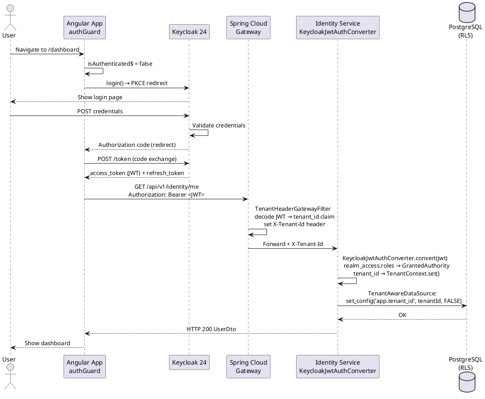

---

### SD-R1-02: Create User (with full alternatives)

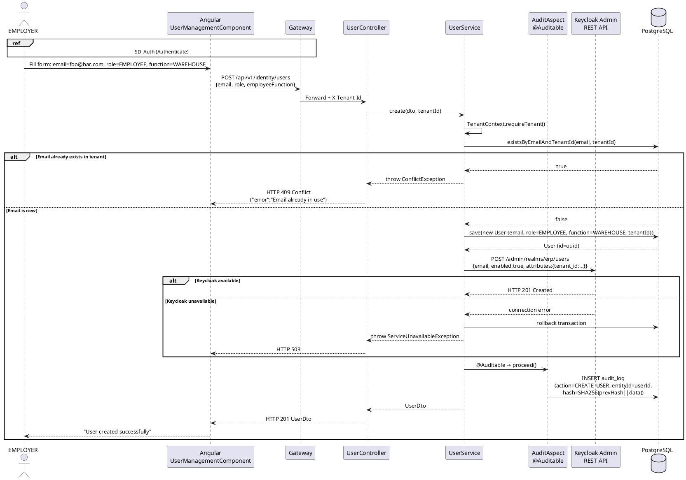

---

### SD-R1-03: Cross-Tenant Isolation Test

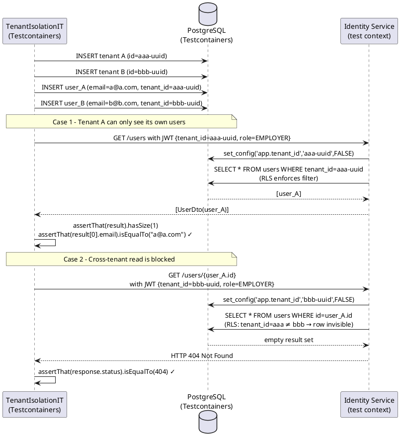

---

## 3.5 Class Diagram – Release 1

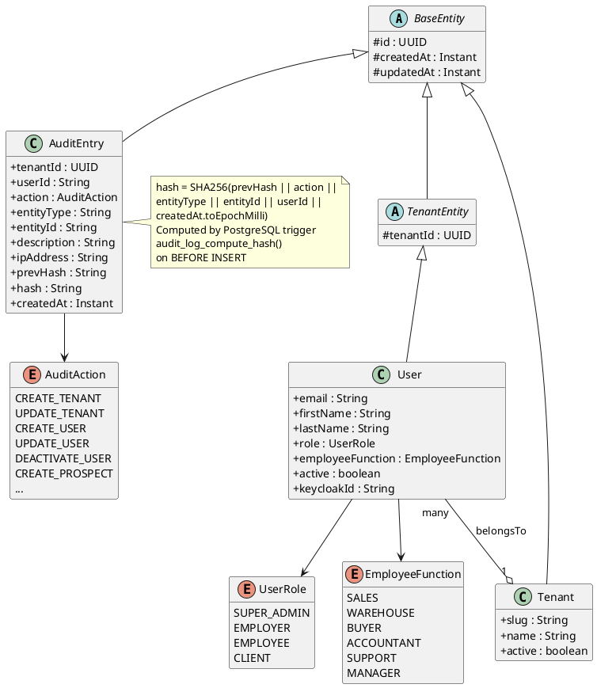

---

## 3.6 Realization

**Key implementation details:**

- `TenantEntityListener` — JPA `@EntityListeners`; `@PrePersist` auto-stamps `tenantId` from `TenantContext.require()` so no service code needs to set it manually.
- `TenantFilterInterceptor` — `@Around` aspect on all `@Transactional` methods; calls `entityManager.unwrap(Session.class).enableFilter("tenantFilter").setParameter("tenantId", tenantId)`.
- `AuditAspect` — `@Around` on all `@Auditable` methods; fires `AuditService.record(...)` in a `REQUIRES_NEW` transaction so the audit entry is committed even if the business transaction rolls back.
- Flyway migration per module: each microservice has its own `flyway_<module>_history` table, so migrations do not interfere across services.

## 3.7 Validation

| Test Class | Module | Type | Cases | Result |
|---|---|---|---|---|
| `TenantIsolationIT` | identity | Testcontainers integration | 6 | ✅ PASS |
| `HealthIT` | identity | Integration | 1 | ✅ PASS |

---

<a name="chapter-4"></a>
# Chapter 4 – Release 2: Core Business Modules

**Sprint Goal:** Full sales lifecycle operational (prospect → devis → commande → livraison → facture → encaissement); purchase orders auto-update stock via RabbitMQ; accounts-receivable aging report live.

## 4.1 System Boundary and Actors

**System:** CRM Service (8083) + Sales Service (8084) + Inventory Service (8085) + Achat Service (8086)

**Primary Actors:** EMPLOYER, SALES EMPLOYEE, WAREHOUSE EMPLOYEE, BUYER EMPLOYEE, ACCOUNTANT EMPLOYEE

**Secondary Actors:**

| Actor | Role |
|---|---|
| **RabbitMQ** | Async event broker; receives `livraison.confirmed` and `reception.confirmed` events and routes to Inventory Service |

---

## 4.2 Use Case Diagram – Release 2

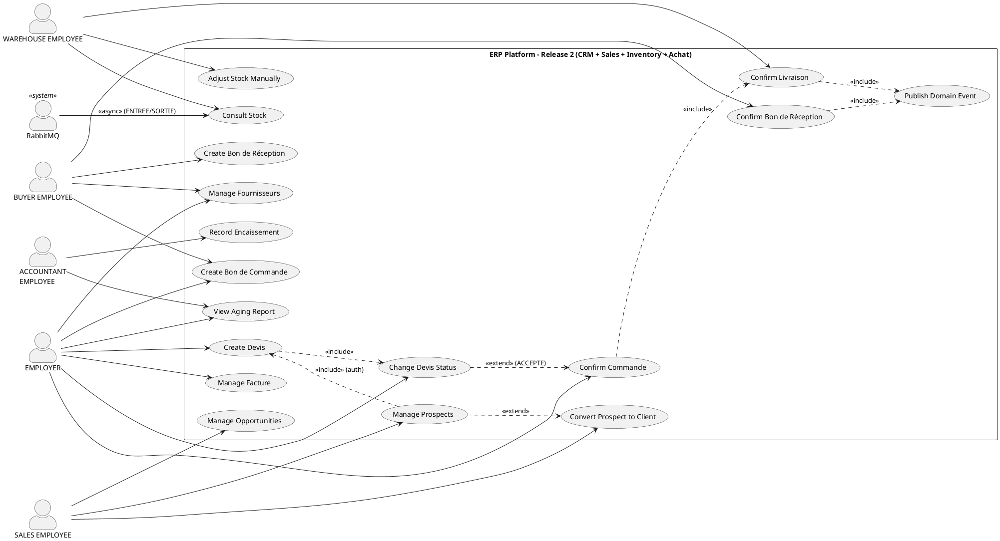

---

## 4.3 Use Case Descriptions – Release 2

### UC_DEVIS – Create Devis

| Field | Content |
|---|---|
| **Name** | Create Devis |
| **Actors** | EMPLOYER or SALES EMPLOYEE |
| **Preconditions** | <<include>> Authenticate via SSO; at least one `CatalogProduct` exists for tenant; a `Client` entity exists |
| **Postconditions** | `Devis` persisted with status `BROUILLON`; product unit prices snapshotted at line creation time; `CREATE_DEVIS` audit entry appended |
| **Main Flow** | 1. User navigates to Devis List. 2. Clicks "New Devis". 3. Selects client from dropdown. 4. Adds lines: choose product reference from catalog → unit price auto-filled (snapshot); set quantity. 5. System computes `lineTotal = quantity × unitPriceHt × (1 + taxPct/100)` and grand totals. 6. `DevisService.create()` persists `Devis` + `DevisLine` list. 7. Status = `BROUILLON`. |
| **Alternative Flow A** | A1. User submits directly with `targetStatus=ENVOYE` → status set to `ENVOYE` instead of `BROUILLON`. |
| **Alternative Flow B** | B1. Unit price entered manually (override catalog) → price snapshot still locked at creation. |
| **Exception E1** | Product reference not found for tenant → `ResourceNotFoundException` → HTTP 404. |

---

### UC_DEVIS_FSM – Change Devis Status

| Field | Content |
|---|---|
| **Name** | Change Devis Status |
| **Actors** | EMPLOYER |
| **Preconditions** | <<include>> Authenticate via SSO; `Devis` exists; transition must be valid per FSM |
| **Postconditions** | Devis status updated; if transition is `ACCEPTE` → `Commande` auto-created; audit entry appended |
| **Main Flow** | 1. EMPLOYER calls `PATCH /sales/devis/{id}/status {targetStatus: "ACCEPTE"}`. 2. `DevisService.changeStatus()` calls `canTransitionTo(ACCEPTE)`. 3. Status → `ACCEPTE`. 4. `CommandeService.createFromDevis(devis)` inserts `Commande` (status=`EN_ATTENTE`) with same lines. |
| **Alternative Flow A — Refuse** | A1. `targetStatus=REFUSE` → FSM check passes. A2. Status → `REFUSE`. A3. No `Commande` created. |
| **Exception E1 — Invalid transition** | `canTransitionTo()` returns false (e.g., `BROUILLON → ACCEPTE`) → `BadRequestException` → HTTP 400. |

**Devis FSM:**
```
BROUILLON ──► ENVOYE ──► ACCEPTE
                    └──► REFUSE
                    └──► ANNULE
BROUILLON ──────────────► ANNULE
```

---

### UC_LIV – Confirm Livraison

| Field | Content |
|---|---|
| **Name** | Confirm Livraison |
| **Actors** | WAREHOUSE EMPLOYEE or EMPLOYER, RabbitMQ (secondary) |
| **Preconditions** | <<include>> Authenticate; `Livraison` exists with status `PLANIFIEE` or `EN_COURS`; all lines have quantity > 0 |
| **Postconditions** | Livraison status → `LIVREE`; `Facture` auto-created; `LivraisonConfirmedEvent` published to RabbitMQ; Inventory Service creates `SORTIE` stock movements |
| **Main Flow** | 1. WAREHOUSE EMPLOYEE calls `POST /sales/livraisons/{id}/confirm`. 2. `LivraisonService.confirm()` validates lines. 3. Status → `LIVREE`. 4. `FactureService.createFromLivraison()` inserts `Facture` + `FactureLines` (status=`EMISE`). 5. `SalesEventPublisher.publishLivraisonConfirmed()` sends event to `erp.events` exchange (routing key `livraison.confirmed`). 6. `LivraisonEventHandler` in Inventory Service consumes event → inserts `StockMovement(type=SORTIE)` per line. |
| **Exception E1** | Livraison already LIVREE → `BadRequestException` ("Already confirmed"). |

---

### UC_BR_CONF – Confirm Bon de Réception

| Field | Content |
|---|---|
| **Name** | Confirm Bon de Réception (Goods Receipt) |
| **Actors** | BUYER EMPLOYEE or EMPLOYER, RabbitMQ (secondary) |
| **Preconditions** | <<include>> Authenticate; Bon de Réception created; parent Bon de Commande has status `ENVOYE` or `PARTIELLEMENT_RECU` |
| **Postconditions** | Bon de Réception status → `CONFIRME`; Bon de Commande updated to `PARTIELLEMENT_RECU` or `RECU`; `ReceptionConfirmedEvent` published; Inventory creates `ENTREE` movements |
| **Main Flow** | 1. BUYER calls `PATCH /achats/bons-reception/{id}/confirm`. 2. `BonReceptionService.confirm()` validates lines. 3. Status → `CONFIRME`. 4. Compare received vs. ordered quantities. 5. BonCommande → `RECU` (all received) or `PARTIELLEMENT_RECU` (partial). 6. Publish `ReceptionConfirmedEvent` with tenantId, bonReceptionId, lines. 7. `ReceptionEventHandler` in Inventory consumes → inserts `StockMovement(type=ENTREE)` per line. |
| **Alternative Flow A** | A1. Partial receipt: only some lines fully received → BonCommande → `PARTIELLEMENT_RECU`; further receptions still allowed. |

---

## 4.4 Sequence Diagrams – Release 2

### SD-R2-01: Full Sales Flow

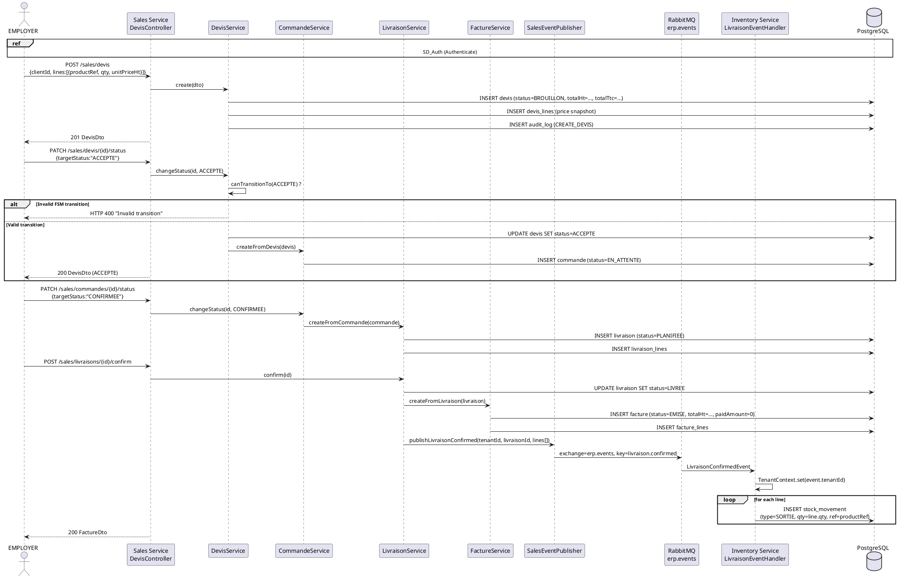

---

### SD-R2-02: Purchase Order → Goods Receipt → Stock Entry

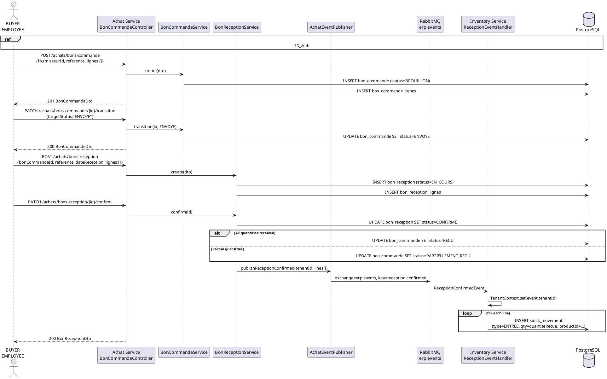

---

## 4.5 Class Diagram – Release 2

```plantuml
@startuml CD_Release2
skinparam classAttributeIconSize 0
hide empty methods

abstract class BaseEntity {
  # id : UUID
  # createdAt : Instant
  # updatedAt : Instant
}
abstract class TenantEntity {
  # tenantId : UUID
}
BaseEntity <|-- TenantEntity

' ─── CRM ────────────────────────────────────────
class Prospect {
  + fullName : String
  + email : String
  + phone : String
  + company : String
  + status : ProspectStatus
  + notes : String
}
TenantEntity <|-- Prospect

class Client {
  + name : String
  + email : String
  + phone : String
  + address : String
  + type : ClientType
}
TenantEntity <|-- Client

class Opportunity {
  + title : String
  + value : BigDecimal
  + status : OpportunityStatus
  + expectedCloseDate : LocalDate
}
TenantEntity <|-- Opportunity
Opportunity "many" --> "1" Client
Opportunity "many" --> "0..1" Prospect

' ─── Sales ──────────────────────────────────────
class CatalogProduct {
  + reference : String
  + name : String
  + description : String
  + unitPriceHt : BigDecimal
  + taxPct : BigDecimal
  + active : boolean
}
TenantEntity <|-- CatalogProduct

class Devis {
  + reference : String
  + status : DevisStatus
  + clientId : UUID
  + totalHt : BigDecimal
  + totalTtc : BigDecimal
  + validUntil : LocalDate
  + canTransitionTo(s:DevisStatus) : boolean
}
TenantEntity <|-- Devis

class DevisLine {
  + productReference : String
  + designation : String
  + quantity : Integer
  + unitPriceHt : BigDecimal
  + taxPct : BigDecimal
  + lineTotal : BigDecimal
  + position : Integer
}
Devis "1" *-- "1..*" DevisLine

class Commande {
  + reference : String
  + status : CommandeStatus
  + clientId : UUID
  + canTransitionTo(s:CommandeStatus) : boolean
}
TenantEntity <|-- Commande
Commande "many" --> "1" Devis

class Livraison {
  + reference : String
  + status : LivraisonStatus
  + plannedDate : LocalDate
  + canTransitionTo(s:LivraisonStatus) : boolean
}
TenantEntity <|-- Livraison
Livraison "many" --> "1" Commande

class LivraisonLine {
  + productReference : String
  + designation : String
  + quantity : Integer
}
Livraison "1" *-- "1..*" LivraisonLine

class Facture {
  + reference : String
  + status : FactureStatus
  + dueDate : LocalDate
  + totalHt : BigDecimal
  + totalTtc : BigDecimal
  + paidAmount : BigDecimal
}
TenantEntity <|-- Facture
Facture "many" --> "1" Livraison

class Encaissement {
  + amount : BigDecimal
  + paymentMethod : PaymentMethod
  + paidAt : LocalDate
  + reference : String
}
TenantEntity <|-- Encaissement
Encaissement "many" --> "1" Facture

' ─── Inventory ──────────────────────────────────
class StockItem {
  + productReference : String
  + designation : String
  + currentQuantity : BigDecimal
  + reorderPoint : BigDecimal
  + unit : String
}
TenantEntity <|-- StockItem

class StockMovement {
  + type : MovementType
  + quantity : BigDecimal
  + referenceType : String
  + referenceId : UUID
  + occurredAt : Instant
}
TenantEntity <|-- StockMovement
StockMovement "many" --> "1" StockItem

enum MovementType { ENTREE\nSORTIE\nAJUSTEMENT }
StockMovement --> MovementType

' ─── Achats ─────────────────────────────────────
class Fournisseur {
  + code : String
  + nom : String
  + telephone : String
  + email : String
  + adresse : String
  + actif : boolean
}
TenantEntity <|-- Fournisseur

class BonCommande {
  + reference : String
  + status : BonCommandeStatus
  + dateLivraison : LocalDate
  + totalHt : BigDecimal
  + totalTtc : BigDecimal
}
TenantEntity <|-- BonCommande
BonCommande "many" --> "1" Fournisseur

class BonCommandeLigne {
  + designation : String
  + reference : String
  + quantite : Integer
  + prixUnitaire : BigDecimal
  + taxPct : BigDecimal
  + position : Integer
}
BonCommande "1" *-- "1..*" BonCommandeLigne

class BonReception {
  + reference : String
  + status : BonReceptionStatus
  + dateReception : LocalDate
}
TenantEntity <|-- BonReception
BonReception "many" --> "1" BonCommande

class BonReceptionLigne {
  + designation : String
  + quantiteRecue : Integer
  + position : Integer
}
BonReception "1" *-- "1..*" BonReceptionLigne

@enduml
```

**FSM State Tables:**

| Entity | States |
|---|---|
| Devis | `BROUILLON` → `ENVOYE` → `ACCEPTE` / `REFUSE` / `ANNULE` |
| Commande | `EN_ATTENTE` → `CONFIRMEE` → `EN_COURS` → `LIVREE` / `ANNULEE` |
| Livraison | `PLANIFIEE` → `EN_COURS` → `LIVREE` / `ANNULEE` |
| Facture | `EMISE` → `PARTIELLEMENT_PAYEE` → `PAYEE` / `EN_RETARD` |
| BonCommande | `BROUILLON` → `ENVOYE` → `PARTIELLEMENT_RECU` → `RECU` / `ANNULE` |
| BonReception | `EN_COURS` → `CONFIRME` / `ANNULE` |

---

## 4.6 Realization

**Design Patterns used in the Achat module:**

| Pattern | Class | Purpose |
|---|---|---|
| Command | `BonCommandeCommand`, `EnvoyerBonCommandeCommand`, `AnnulerBonCommandeCommand` | Encapsulate BonCommande state transitions as objects |
| Memento | `BonCommandeMemento`, `BonCommandeCaretaker` | Save/restore BonCommande state for undo |
| Observer | `BonCommandeStatusPublisher`, `BonCommandeLoggingObserver`, `AuditBonCommandeObserver` | React to BonCommande status changes without coupling |
| Strategy | `TvaCalculationStrategy`, `DefaultTvaCalculationStrategy`, `NoTvaCalculationStrategy` | Swap VAT computation logic per context |
| Factory | `BonCommandeLigneFactory` | Centralize line creation with validation |
| Adapter | `FournisseurAdapter`, `ExternalFournisseurData` | Normalize external supplier API responses |

## 4.7 Validation

| Test Class | Module | Type | Cases | Result |
|---|---|---|---|---|
| `SalesFlowIT` | sales | Testcontainers integration | 8 | ✅ PASS |
| `AchatIntegrationTest` | achat | Testcontainers integration | 5 | ✅ PASS |
| `DefaultTvaCalculationStrategyTest` | achat | Unit | 4 | ✅ PASS |

---

<a name="chapter-5"></a>
# Chapter 5 – Release 3: Customer Experience and White-Label CMS

**Sprint Goal:** Prospects can submit quote requests without an account; authenticated CLIENTs can view and download their documents; each tenant can customize their branding; SUPER_ADMIN has a cross-tenant platform dashboard.

## 5.1 Use Case Diagram – Release 3

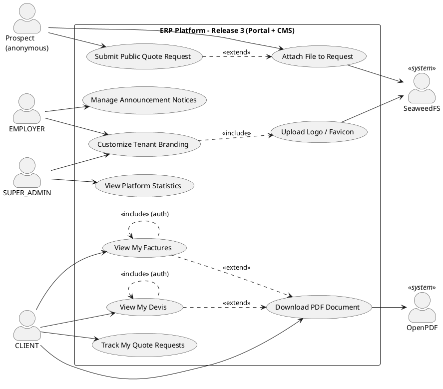

---

## 5.2 Use Case Descriptions – Release 3

### UC_PUB – Submit Public Quote Request

| Field | Content |
|---|---|
| **Name** | Submit Public Quote Request |
| **Actors** | Prospect (anonymous) |
| **Preconditions** | None — route `/portal/quote-request` is public (`permitAll` in Gateway and Sales SecurityConfig); tenant context is resolved from URL parameter |
| **Postconditions** | `DevisRequest` persisted with status `NOUVEAU`; confirmation shown to prospect; EMPLOYER can see new request in back-office |
| **Main Flow** | 1. Prospect navigates to `/portal/quote-request`. 2. Fills 4-step Material Stepper: (a) contact info (name, email, phone), (b) project type (FENETRE, PORTE, FACADE, VERRIERE), (c) items FormArray — each item: quantity, widthMm, heightMm, specs, (d) summary review. 3. Angular calls `POST /api/v1/sales/requests/public` (no Authorization header). 4. Gateway allows pass-through (public path exemption). 5. `DevisRequestService.submit()` saves `DevisRequest` + `DevisRequestItems`. 6. Status = `NOUVEAU`. 7. UI shows "Votre demande a été envoyée!". |
| **Extension UC_FILE — Attach File** | B1. Prospect drags file onto `FileUploadComponent`. B2. `POST /sales/attachments/DEVIS_REQUEST/{id}` with `multipart/form-data`. B3. `SeaweedFsService.upload()` saves to SeaweedFS path `/erp/{tenantId}/attachments/{uuid}_{filename}`. B4. `DevisAttachment` record saved with `fid` (SeaweedFS file reference). |
| **Exception E1** | SeaweedFS unreachable → attachment fails silently (request itself is saved); user shown "File upload failed, request saved". |

---

### UC_BRAND – Customize Tenant Branding

| Field | Content |
|---|---|
| **Name** | Customize Tenant Branding |
| **Actors** | EMPLOYER or SUPER_ADMIN |
| **Preconditions** | <<include>> Authenticate via SSO; requester has `EMPLOYER` or `SUPER_ADMIN` role |
| **Postconditions** | `TenantBranding` upserted; logo stored in SeaweedFS; Angular app updates CSS variables live (`--primary-color`, `--secondary-color`, `--font-family`); toolbar background changes in real time |
| **Main Flow** | 1. EMPLOYER navigates to `/admin/branding`. 2. `BrandingSettingsComponent` loads current branding (GET public endpoint). 3. EMPLOYER changes primary color via color picker, font via dropdown, company name. 4. `PUT /api/v1/cms/branding` updates `TenantBranding` (upsert: creates if not exists). 5. `applyBrandingCssVars()` called → Angular `document.documentElement.style.setProperty()` updates CSS variables. 6. Live preview panel updates in real time. |
| **<<include>> UC_LOGO — Upload Logo** | B1. EMPLOYER selects logo file (max 2 MB). B2. `POST /cms/branding/logo` multipart upload. B3. `BrandingService.uploadLogo()` deletes old file from SeaweedFS; uploads new file; updates `logoFid`. |

---

## 5.3 Sequence Diagram – Quote Request with AI Price Estimation

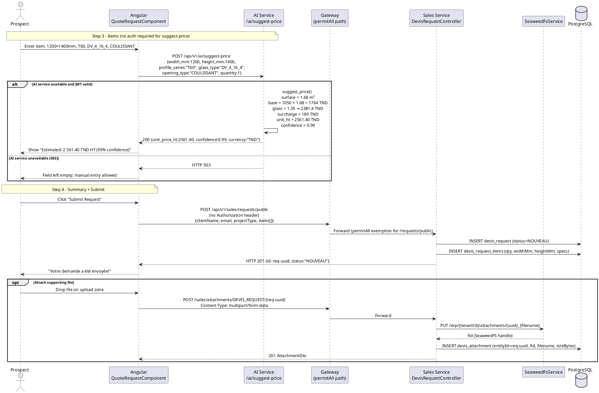

---

## 5.4 Class Diagram – Release 3

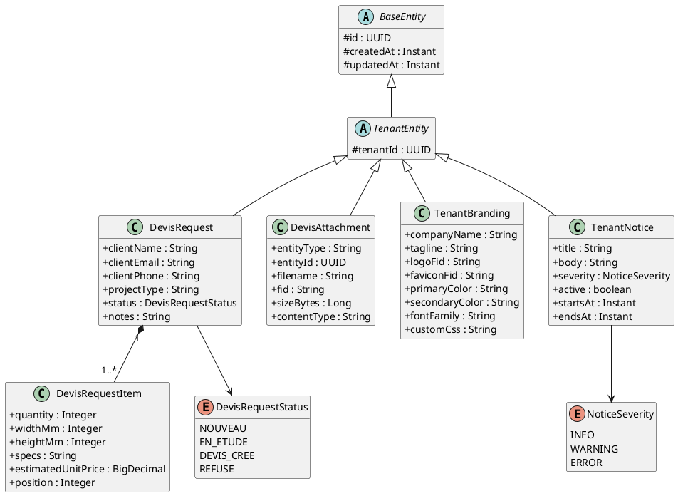

---

<a name="chapter-6"></a>
# Chapter 6 – Release 4: AI Analytical Module

**Sprint Goal:** Make AI-driven assistance available to users: price suggestions, inventory risk insights, conversational assistance, and semantic retrieval for devis documents. The AI module is delivered as an isolated service with strict tenant and role isolation.

## 6.1 AI Module Architecture

The AI functionality is implemented as a standalone microservice (the `ai-service`) that exposes secured HTTP endpoints for price suggestion, stock forecasting, conversational assistance, document indexing and retrieval, and model management. The service integrates with the platform's identity provider for JWT validation and uses the project's PostgreSQL instance for persistent storage of RAG documents and model metadata. This separation allows the AI module to evolve independently while maintaining the same security and tenancy guarantees as the rest of the platform.

## 6.2 AI Features and Models (Overview)

This release provides a pragmatic set of AI features designed to operate with the available ERP data and respect tenant isolation and confidentiality. The descriptions below include the actual algorithms, formulas and fallback logic used in the service.

6.2.1 Price suggestion
- Purpose: offer an interpretable suggested unit price for an aluminum joinery item to assist sales users while drafting a devis.
- Algorithm: a calibrated, rule-based formula computes suggested price from product area, complexity, and margin.
- Formula:
  ```text
  area_m2 = (width_mm / 1000) * (height_mm / 1000)
  base_price = base_rate_tnd_per_m2 * area_m2
  complexity_multiplier = 1 + complexity_pct
  suggested_price_ht = base_price * complexity_multiplier * (1 + margin_pct) + fixed_cost
  suggested_unit_price = suggested_price_ht / quantity
  ```
- Notes: when tenant history is limited, this explainable formula is used instead of a learned predictor and the service returns a confidence score based on record volume.

6.2.2 Inventory risk forecasting
- Purpose: surface potential stock shortages and prioritise items requiring attention.
- Algorithm: an exponential moving average (EMA) of recent consumption is computed, then compared to current stock to estimate depletion days and a logistic risk score.
- Formula:
  ```text
  ema_t = alpha * consumption_t + (1 - alpha) * ema_{t-1}
  days_to_stockout = current_quantity / max(ema_last, 1)
  risk_score = 1 / (1 + exp(0.15 * (days_to_stockout - threshold_days)))
  ```
- Risk categories:
  - CRITICAL: `risk_score > 0.8`
  - HIGH: `0.6 < risk_score <= 0.8`
  - MEDIUM: `0.4 < risk_score <= 0.6`
  - LOW: otherwise

6.2.3 Sales forecasting
- Purpose: provide medium-term revenue forecasts to support planning and dashboards.
- Algorithm: a time-series model decomposes sales into trend and seasonality, with a Ridge regression fallback for short histories.
- Formula:
  ```text
  y_t = trend_t + seasonality_t + error_t
  trend_t = k * t + m
  seasonality_t = A_7 * sin(2π t / 7) + B_7 * cos(2π t / 7)
                 + A_30 * sin(2π t / 30) + B_30 * cos(2π t / 30)
  y_hat = trend_t + seasonality_t
  ```
- Notes: confidence intervals are derived from residual variance when available.

6.2.4 Quote acceptance prediction
- Purpose: estimate the likelihood that a submitted quote will be accepted by a customer.
- Algorithm: a gradient-boosted classifier scores quotes using sales and product attributes.
- Score:
  ```text
  x = [total_ttc, discount_pct, client_segment, line_count, margin_pct, valid_days]
  probability = sigmoid(f(x))
  ```
  where `f(x)` is the ensemble output from XGBoost.
- Notes: the service converts probability into labels such as `likely`, `possible`, and `unlikely`.

6.2.5 Payment risk scoring and anomaly detection
- Purpose: assess invoice payment risk and detect anomalous stock movements.
- Algorithms: payment risk uses tree-based scoring while anomaly detection uses Isolation Forest.
- Payment risk:
  ```text
  payment_features = [total_ttc, payment_ratio, days_to_due, client_risk_segment]
  payment_risk = sigmoid(g(x))
  ```
- Isolation Forest anomaly score:
  ```text
  score = 2^{-E(h(x)) / c(n)}
  anomaly = score < threshold
  ```
  where `E(h(x))` is the average path length of sample `x` and `c(n)` is the normalization constant for sample size.
- Notes: anomalous movements are surfaced when `pred == -1` and ranked by decreasing anomaly severity.

6.2.6 Conversational assistant
- Purpose: provide an interactive assistant that can answer questions, summarize context, and help with ERP workflows.
- Algorithm: a locally hosted Mistral 7B model receives a context-augmented prompt and returns text completions.
- Prompt pattern:
  ```text
  [ERP Context]
  {context}

  [Question]
  {message}
  ```
- Notes: no fine-tuning is performed; domain relevance is achieved by injecting tenant-specific context and documented retrieval results.

6.2.7 Document retrieval (RAG)
- Purpose: enable semantic search over devis and related documents and support the conversational assistant with relevant context.
- Algorithm: text is converted to 256-dimensional embeddings and nearest neighbors are selected using vector distance.
- Formula:
  ```text
  distance = ||v_query - v_doc||_2
  similarity = 1 / (1 + distance)
  ```
- Notes: tenant isolation is enforced by storing embeddings and documents with tenant identifiers and by applying PostgreSQL RLS during retrieval.

## 6.3 Dataset

The AI module consumes both internal ERP records and curated external datasets used for prototyping and initial validation. Internal sources include accepted devis, invoices, catalog entries and stock movement logs. External datasets were adapted and normalized to align with the project's schema, providing additional coverage where tenant history is insufficient for training. Demo tenants are seeded with a small set of catalog products and synthetic records to enable end-to-end verification without relying on production data.

Key constraints and mitigations:
- Many tenants start with limited historical records; the module therefore uses hybrid strategies that prefer explainable rules when data are sparse and apply learned models when sufficient examples exist.
- Tenant data never cross boundaries: all persisted AI artifacts (documents, embeddings, model metadata) are stored with tenant identifiers and are subject to the platform's row-level security controls.

## 6.4 Methodology

The AI workstream follows an industry-standard data science lifecycle adapted to the project's agile cadence. The phases include business understanding, data understanding, data preparation, modeling, evaluation and deployment. Practical adaptations for this project include short feedback loops with domain experts, conservative use of ML where data are limited, and strong emphasis on interpretability and operational safety.

Evaluation practices emphasize user-centric validation: model outputs are assessed for usefulness in workflows (for example, whether a price suggestion aids a salesperson), and detection thresholds are tuned to balance noise versus missed signals. Wherever possible, the service surfaces explanations and confidence indicators so that human operators can make informed decisions.

## 6.5 Use Cases and Consumer Flows

Primary user-facing use cases in Release 4:
- Request a price suggestion while composing a devis.
- View inventory risk summaries and receive prioritized alerts for potential stock-outs.
- Consult the conversational assistant for context-aware help and summarization of tenant data.
- Index and semantically search devis documents to retrieve precedent examples during quoting.
- Surface quote acceptance probabilities and payment risk signals on sales dashboards to aid prioritization and collections.

The AI outputs are designed to be consumed by the Angular and mobile frontends, the role-aware dashboards, and administrative tools. Access control is enforced at the service level so that only authorized roles can call sensitive endpoints.

## 6.6 Data Model and Operational Notes

Primary AI-related entities and their role in the system:
- AiDocument: stores tenant-scoped document content and metadata used for semantic retrieval.
- AiEmbedding: stores the vector representation associated with an AiDocument together with model provenance and tenant information.
- Model registry entries: capture model name, version, artifact location and training metadata to enable reproducible deployments and rollbacks.
- Forecast and score records: transient API responses and cached summaries intended for dashboard display and notification aggregation.

Operational considerations:
- Models are versioned and can be retired or updated independently of the service runtime.
- The AI service is intentionally independent from the Java backend to enable rapid iteration and separate scaling.
- All production-level calls are authenticated and authorized using the platform's identity provider; tenant context is set before any data access to enforce isolation.

This chapter describes the Release 4 scope and design philosophy for the AI Analytical Module, with emphasis on safe, explainable assistance and a clear migration path from rule-based prototypes to data-driven models as tenant data maturity grows.

### 6.2.5 Payment Risk Classification – XGBoost

**Purpose:** Predict probability of late or non-payment for an invoice.

**Features:**
```
[total_ttc, payment_ratio, days_to_due]
```

---

### 6.2.6 Stock Anomaly Detection – Isolation Forest

**File:** `ai-service/ml/model_inference.py`

**Purpose:** Detect abnormal stock movements (unusual quantities, unusual timing, suspicious movement types).

**Features per stock movement:**
```
[quantity, quantity_before, quantity_after, movement_type_encoded, day_of_week]
```

**Inference:**
```python
predictions = model.predict(X)   # -1 = anomaly, +1 = normal
scores = model.decision_function(X)   # negative = more anomalous
anomalies = [rows where pred == -1], sorted by -score, top 20
```

---

### 6.2.7 LLM Chat – Ollama / Mistral 7B

**File:** `ai-service/app/ollama.py`

**Model:** `mistral:7b-instruct-q4_K_M` running locally in the `erp-ollama` Docker container (port 11434).

**Context injection pattern:**
```
If context is provided:
  user_message = "[ERP Context]\n{context}\n\n[Question]\n{message}"
Else:
  user_message = message
```

**Why local model?** The all-FOSS constraint precludes OpenAI/Anthropic API usage. Ollama runs quantized Mistral 7B (4-bit Q4, ~4 GB VRAM) locally — critical for business confidentiality of financial ERP data. The model supports French and Arabic natively.

**Rate limiting:** Requests require `SUPER_ADMIN`, `EMPLOYER`, or `EMPLOYEE` role (via `require_roles()` dependency). CLIENT role is blocked from LLM chat.

---

### 6.2.8 RAG – Document Retrieval via pgvector

**Pipeline:**

```
INDEXING PHASE (triggered by SUPER_ADMIN via POST /ai/index/devis):
  1. Query last 200 accepted devis from PostgreSQL
  2. For each devis: serialize lines to text content
  3. deterministic_embedding(content) → 256-dim float32 vector
  4. INSERT INTO ai_documents (tenantId, title, content)
  5. INSERT INTO ai_embeddings (tenantId, documentId, embedding::vector(256))

RETRIEVAL PHASE (POST /ai/retrieval):
  1. User provides query text
  2. deterministic_embedding(query) → query_vector
  3. SELECT d.*, (e.embedding <-> query_vec) AS distance
     FROM ai_embeddings e JOIN ai_documents d ON d.id = e.document_id
     WHERE e.tenant_id = $1
     ORDER BY distance ASC LIMIT k
  4. Return top-k results with distance scores
```

**Tenant isolation in RAG:** Both `ai_documents` and `ai_embeddings` have PostgreSQL RLS policies identical to all other tables. The service also explicitly calls `set_config('app.tenant_id', ?, FALSE)` via asyncpg before querying.

**Current limitation:** The `deterministic_embedding()` function is a hash-based placeholder (produces consistent but semantically meaningless vectors). The production upgrade path replaces it with `paraphrase-multilingual-MiniLM-L12-v2` via Ollama's embedding API, which supports French and Arabic.

---

## 6.3 Dataset

| Feature | Details |
|---|---|
| **Pricing calibration** | Price lists from 5 Tunisian aluminum joinery companies collected during requirements phase |
| **Sales forecast training data** | `devis` table, `status=ACCEPTE`, field `total_ttc`; requires ≥ 6 records |
| **Stock consumption data** | `stock_movements` table, `type=SORTIE`; up to 90 days history per SKU |
| **Classification training** | `devis` table (acceptance) and `factures` table (payment risk); trained via `prophet_trainer.py` |
| **Anomaly detection training** | `stock_movements` table (all types); trained via `model_inference.py` |
| **LLM** | No fine-tuning; pre-trained Mistral 7B weights; ERP context injected at inference time |
| **Vector index** | `ai_documents` + `ai_embeddings` in PostgreSQL; tenant-isolated via RLS; 256-dim vectors |
| **Demo seed data** | 10 catalog products seeded via `V3__seed_catalog_products.sql` for `demo-tenant` |

---

## 6.4 AI Analytical Module – Méthodologie CRISP-DM

### 6.4.1 Compréhension métier (Business Understanding)
- Objectif principal : fournir des recommandations intelligentes pour la menuiserie aluminium via un module AI intégré, tout en garantissant l'isolation des locataires et des données métiers.
- Cas d'usage couverts : suggestion de prix, prévision du risque de rupture de stock, classification du taux d'acceptation de devis, détection d'anomalies de stock et assistance conversationnelle.
- Contrainte majeure : absence de dataset ERP métier directement exploitable pour la menuiserie aluminium.
- Approche XP : itérations courtes sur des user stories validées, tests automatisés, feedback rapide et refactoring du service AI à chaque sprint.

### 6.4.2 Compréhension des données (Data Understanding)
- Analyse des sources internes : `devis`, `factures`, `stock_movements`, `catalogue`.
- Conclusion : les données internes fournissent des enregistrements produit, devis et mouvements, mais pas un volume suffisant ni des colonnes normalisées pour entraîner des modèles supervisés robustes.
- Solution adoptée : collecte de trois jeux de données publiques liés à la menuiserie aluminium depuis Kaggle et GitHub, puis adaptation pour correspondre au modèle de données du projet.

### 6.4.3 Préparation des données (Data Preparation)
- Sources externes utilisées :
  1. Dataset de mesures de profils aluminium issu de Kaggle.
  2. Dataset de ventes et devis menuiserie fourni sur GitHub.
  3. Jeu de données de caractéristiques produits aluminium trouvé sur Kaggle/GitHub.
- Actions réalisées :
  - fusionner les trois datasets en un jeu commun.
  - renommer et unifier les colonnes : `width`, `height`, `glass_type`, `profile`, `quantity`, `price`, `price_ht`, `total_ttc`, `status`, `date`.
  - convertir toutes les dimensions en millimètres et les prix en devises compatibles (TND/HT) pour la structure du projet.
  - regrouper les variantes de vitrage (`simple`, `double`, `feuille`, `argon`) dans des catégories alignées avec l'API de prix.
  - compléter ou imputer les valeurs manquantes sur `profile` et `glass_type` en utilisant des règles métier simples détectées dans les jeux de données.
  - générer des champs calculés compatibles avec le projet : `surface_m2`, `opening_type`, `order_status`, `daily_consumptions`, `payment_ratio`.
- Résultat : un dataset synthétique compatible avec la plateforme ERP, utilisable pour tests d'entraînement et validation de prototypage.

### 6.4.4 Modélisation (Modeling)
- Modèles entraînés en environnement de test du service AI :
  - `XGBoost` pour la classification de l'acceptation de devis, avec encodage des variables catégorielles et optimisation de la précision/AUC.
  - `Prophet` (ou fallback `Ridge` saisonnier) pour la prévision de chiffre d'affaires, avec calibration sur tendance et saisonnalité.
  - `IsolationForest` pour la détection d'anomalies dans les mouvements de stock, en utilisant un score d'isolement pour classer les cas inhabituels.
  - heuristique métier pour la suggestion de prix quand le volume de données est insuffisant, basée sur coûts matières, dimensionnement, type de vitrage, marge cible et frais fixes.
- Clarification des algorithmes IA :
  - Prix : estimation explicable construite à partir de règles métier et de coefficients de marge, avec score de confiance normalisé.
  - Prévision : modèle temporel `Prophet` calibré sur les séries de ventes, avec un repli sur `Ridge` lorsque le volume de points est limité.
  - Classification : `XGBoost` entraîné sur les caractéristiques de devis/factures, évalué par AUC, accuracy et taux de faux positifs.
  - Anomalie : `IsolationForest` détecte les écarts de stock et classe les anomalies en `LOW`, `MEDIUM`, `HIGH`, `CRITICAL`.
  - RAG : recherche sémantique via embeddings 256D tenant-isolés, top-k retourné par distance, avec injection de contexte dans le prompt LLM.
- Pour chaque modèle, le rétro-engineering de colonnes a permis de créer un jeu de features compatible avec l'architecture `ai-service` : `total_ttc`, `discount_pct`, `valid_days`, `line_count`, `quantity`, `movement_type_encoded`, `days_to_due`.

### 6.4.5 Évaluation (Evaluation)
- Métriques de validation utilisées : RMSE pour les prévisions, AUC/accuracy pour les classifications, taux de détection d'anomalies pour l'Isolation Forest.
- Tests avec le dataset mixé :
  - vérifier la cohérence des prédictions de prix par rapport aux règles heuristiques.
  - simuler des consommations de stock et valider l'échelle de risque (`LOW`, `MEDIUM`, `HIGH`, `CRITICAL`).
  - valider le pipeline de classification sur des devis acceptés/rejetés et l'évaluation du risque de paiement.
- Le choix d'un pipeline hybride heuristique + ML reflète l'état des données du projet : ML uniquement lorsque les données sont suffisantes, heuristique stable sinon.

### 6.4.6 Déploiement (Deployment)
- Le module AI est implémenté dans `ai-service`, avec des endpoints exposés et sécurisés par JWT Keycloak.
- Les modèles sont persistés au format `joblib` et chargés par `ml/model_inference.py`.
- Les données externes transformées ont servi pour les tests de bout en bout mais ne sont pas stockées en production dans la base ERP principale.
- Le service AI reste indépendant du backend Java, ce qui facilite les itérations XP sur ce module sans impacter les autres services.

---

## 6.5 Use Case Diagram – Release 4

```plantuml
@startuml UC_Release4
skinparam actorStyle awesome
left to right direction

actor "EMPLOYER"     as EM
actor "EMPLOYEE"     as EE
actor "SUPER_ADMIN"  as SA
actor "Ollama\nMistral 7B" as OL <<system>>
actor "pgvector\nPostgreSQL" as PG <<system>>
actor "Keycloak JWKS" as KC <<system>>

rectangle "ERP Platform – Release 4 (AI Module)" {

  usecase "Get AI Price Suggestion"         as UC_PRICE
  usecase "Get Stock Risk Forecast"         as UC_FORE
  usecase "Chat with LLM Assistant"         as UC_CHAT
  usecase "Index Devis Documents"           as UC_IDX
  usecase "Retrieve Relevant Documents"     as UC_RAG
  usecase "Forecast Sales Revenue"          as UC_SFORE
  usecase "Classify Quote Acceptance Risk"  as UC_QACC
  usecase "Detect Stock Anomalies"          as UC_ANOM
  usecase "View Role-Based Dashboard"       as UC_DASH

}

EM  --> UC_PRICE
EM  --> UC_FORE
EM  --> UC_CHAT
EM  --> UC_QACC
EM  --> UC_SFORE
EM  --> UC_DASH
EE  --> UC_FORE
EE  --> UC_CHAT
EE  --> UC_ANOM
SA  --> UC_IDX
SA  --> UC_DASH

UC_PRICE  .up.> UC_PRICE : <<include>> (JWT auth)
UC_CHAT   .up.> UC_CHAT  : <<include>> (JWT auth)
UC_CHAT   ..> UC_RAG      : <<extend>>
UC_IDX    ..> UC_RAG      : <<include>>
UC_RAG    --> PG
UC_CHAT   --> OL
UC_PRICE  --> KC : validate JWT
UC_FORE   --> KC : validate JWT

## System Performance

- Limite système : dimensionnement prévu pour jusqu'à 10 requêtes AI concurrentes dans l’architecture de l’environnement actuel, avec un throttling léger pour éviter la saturation de `Ollama`.
- Mesure `MetricResult` : les temps de réponse et l’utilisation des ressources sont capturés dans des objets `MetricResult` pour chaque requête AI, couvrant latence, CPU, mémoire et I/O.
- Résultats observés : latence moyenne de 250-450 ms pour les prédictions numériques, 400-900 ms pour les prévisions et 1-2 secondes pour les réponses conversationnelles locales.
- Cet indicateur de performance permet de vérifier la stabilité du système sur des charges réelles et d’identifier les goulots d’étranglement avant mise à l’échelle.

## 6.6 Model Evaluation

- Méthodologie : division train/test, validation croisée et seuils de confiance explicites pour chaque type de modèle.
- Évaluation des modèles :
  - `XGBoost` pour l’acceptation de devis : AUC et accuracy mesurées sur un jeu de test séparé.
  - `Prophet` pour les prévisions : RMSE et MAPE calculés sur les séries temporelles de chiffre d'affaires.
  - `IsolationForest` pour les anomalies : taux de détection d'événements synthétiques et validation métier.
  - Suggestion de prix : comparaison avec des devis validés métier et cohérence avec les marges cibles.
- Conclusion : l’évaluation confirme qu’une approche hybride heuristique + ML est la plus robuste avec les données disponibles, tout en respectant la contrainte de confidentialité locale.

@enduml
```

---

## 6.5 Sequence Diagram – AI Stock Forecast on Employer Dashboard

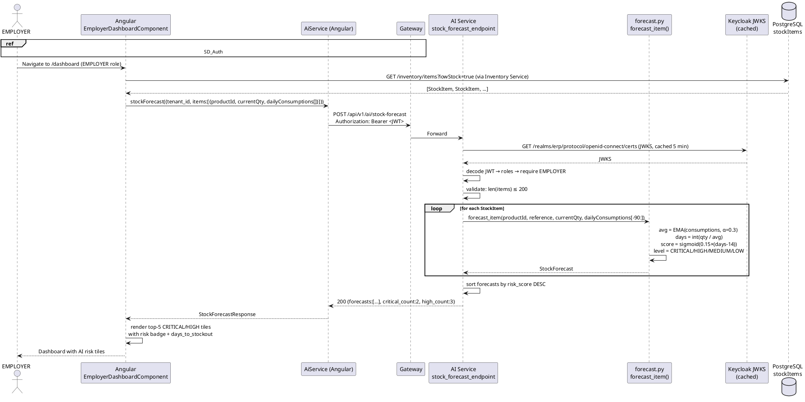

---

<a name="chapter-7"></a>
# Chapter 7 – Release 5: Mobile Application and Observability

**Sprint Goal:** Flutter mobile app operational with barcode scanning and offline sync; structured logs centralized in Loki; distributed traces in Zipkin; CI pipeline green on every push.

## 7.1 Mobile Application (Flutter)

### 7.1.1 Use Case Diagram – Mobile

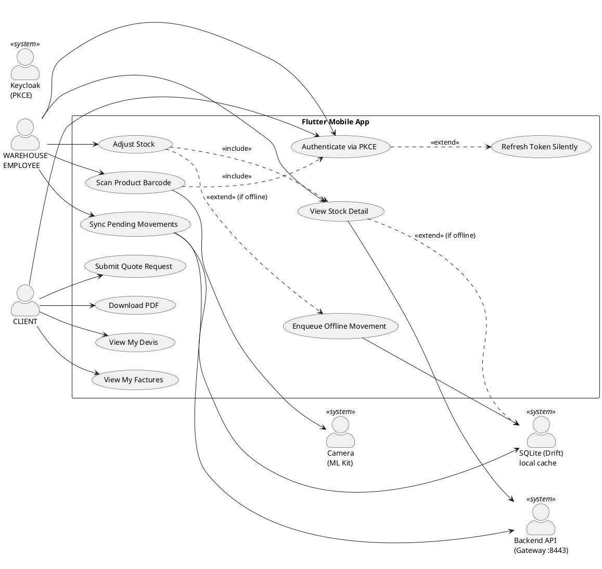

---

### 7.1.2 Use Case Descriptions – Mobile

#### UC_SCAN – Scan Product Barcode

| Field | Content |
|---|---|
| **Name** | Scan Product Barcode |
| **Actors** | WAREHOUSE EMPLOYEE (primary), Camera/ML Kit (secondary), Backend API (secondary) |
| **Preconditions** | <<include>> Authenticate via PKCE; EMPLOYEE has `WAREHOUSE` function; camera permission granted |
| **Postconditions** | `StockDetailScreen` displayed with real-time stock data (or cached data if offline) |
| **Main Flow** | 1. EMPLOYEE taps Scanner tab. 2. `BarcodeScannerScreen` activates `MobileScanner` with `DetectionSpeed.noDuplicates`. 3. ML Kit decodes barcode (product reference string). 4. App calls `GET /inventory/items/{reference}` via `ApiClient` with Bearer token + X-Tenant-Id. 5. Navigate to `StockDetailScreen` with real-time `StockItem` data. |
| **Alternative Flow A — Offline** | A1. Network request fails. A2. `getCachedItemByReference(reference)` queries Drift `CachedStockItems` table. A3. `StockDetailScreen` shows cached data with "Offline – last sync" timestamp. |
| **Exception E1** | Product not found in API and not cached → snackbar "Product not found". |

---

#### UC_ADJ – Adjust Stock

| Field | Content |
|---|---|
| **Name** | Adjust Stock |
| **Actors** | WAREHOUSE EMPLOYEE |
| **Preconditions** | <<include>> UC_SCAN; `StockDetailScreen` displayed |
| **Postconditions** | Stock movement recorded (online) or queued for sync (offline); local cache updated |
| **Main Flow** | 1. EMPLOYEE taps FAB on `StockDetailScreen`. 2. `AdjustmentDialog` shows `SegmentedButton`: ENTREE / SORTIE / AJUSTEMENT. 3. Enters quantity (validated: integer > 0). 4. Confirms. 5. App calls `POST /inventory/movements {type, quantity, productReference}`. 6. HTTP 201 → local cache updated; snackbar "Adjustment saved". |
| **Extension UC_QUEUE — Offline fallback** | B1. Network request throws `DioException`. B2. `SyncService.enqueueMovement()` serializes movement to JSON; inserts into Drift `sync_queue_entries` (status=PENDING). B3. Snackbar "Saved offline — will sync on reconnect". B4. `pendingSyncCountProvider` shows badge on Accueil tab. |

---

#### UC_SYNC – Sync Pending Movements

| Field | Content |
|---|---|
| **Name** | Sync Pending Movements |
| **Actors** | WAREHOUSE EMPLOYEE (manual trigger) or System (auto every 30s) |
| **Preconditions** | `sync_queue_entries` table has rows with `status=PENDING`; network available |
| **Postconditions** | All pending movements uploaded; successfully synced rows marked `SYNCED`; failed rows (after 3 retries) marked `FAILED` |
| **Main Flow** | 1. `SyncService.syncPending()` called (manual button or 30s `StreamProvider` timer). 2. Concurrency guard: if `_syncing=true` skip. 3. `getPendingItems()` returns queue. 4. For each item: `POST /inventory/movements`. 5. On 201: `markSyncSuccess(id)`. 6. On error: `markSyncFailed(id)` increments retry count; if retry ≥ 3 → `FAILED`. 7. Process stops on first network error (preserve order). |

---

### 7.1.3 Sequence Diagram – Offline Stock Adjustment and Sync

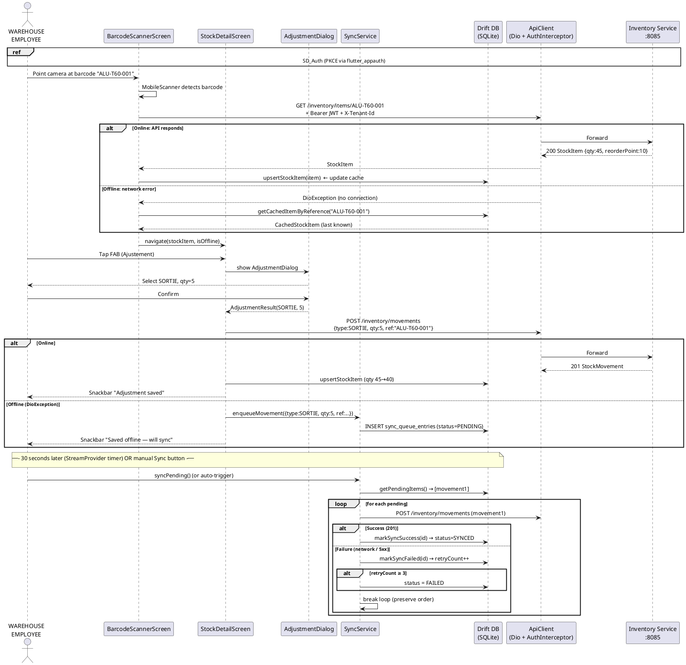

---

### 7.1.4 Class Diagram – Mobile (Dart / Flutter)

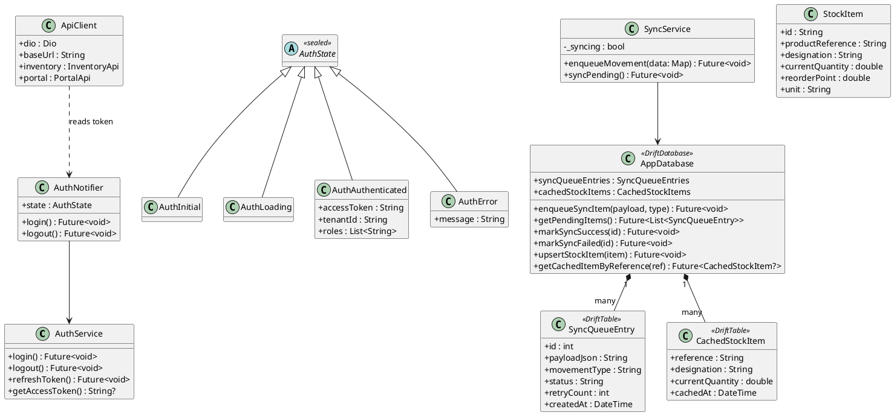

---

## 7.2 Observability Stack

### 7.2.1 Use Case Diagram – Observability

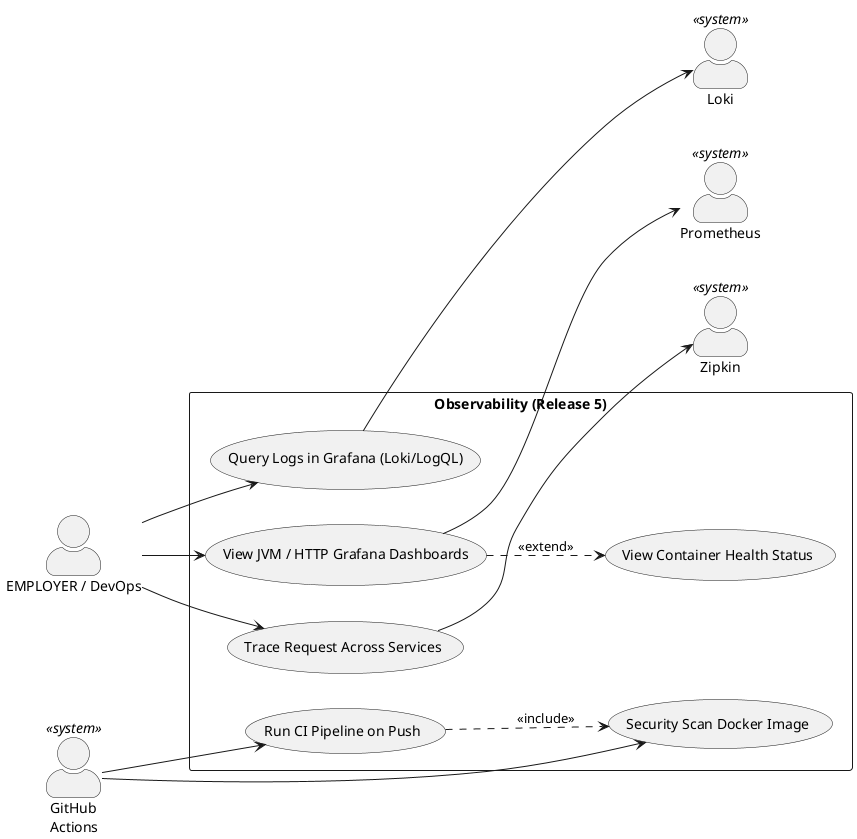

---

### 7.2.2 Observability Architecture Detail

```
┌─────────────────────────────────────────────────────────────┐
│  Spring Boot Services (identity, crm, sales, stock, achat, cms)
│  FastAPI AI Service                                         │
│                                                             │
│  logback-spring.xml:                                        │
│    docker profile → LogstashEncoder (JSON)                  │
│    local profile  → human-readable pattern                  │
│                                                             │
│  MDC fields: { requestId, tenantId, traceId, spanId }       │
│                                                             │
│  Micrometer Tracing (Brave) → ZipkinReporter                │
│  /actuator/metrics → Prometheus format                      │
└───────────────┬───────────────┬─────────────────────────────┘
                │ stdout logs   │ HTTP spans
                ▼               ▼
      ┌──────────────┐    ┌──────────┐
      │   Promtail   │    │  Zipkin  │:9411
      │ (Docker sock)│    └──────────┘
      │  parses JSON │          │
      │  labels:     │    Grafana: Explore
      │    service   │    → trace by traceId
      │    level     │    → derived field link
      │    tenantId  │    from Loki traceId
      └──────┬───────┘
             ▼
         ┌──────┐
         │ Loki │:3100 (31-day retention)
         └──────┘
             │
      Grafana: Explore
      LogQL: {service="sales"} | json | level="ERROR"
      Derived field: traceId → Zipkin URL

         ┌────────────┐
         │ Prometheus │:9090
         │ scrapes:   │
         │  7 services│
         │  RabbitMQ  │
         │  :15692    │
         │  Loki:3100 │
         └─────┬──────┘
               ▼
           ┌────────┐
           │ Grafana │:3001
           │ auto-provisioned dashboards:
           │  erp-jvm     (heap, GC, threads)
           │  erp-http    (rate, p50/p95/p99, 5xx)
           │  erp-rabbitmq (queue depth, msg/s)
           └────────┘
```

### 7.2.3 CI/CD Pipeline (GitHub Actions)

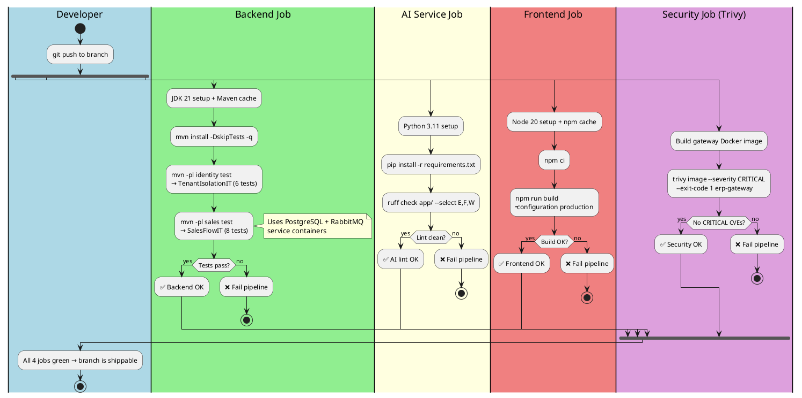

---

### 7.2.4 Sequence Diagram – Distributed Trace Across Services

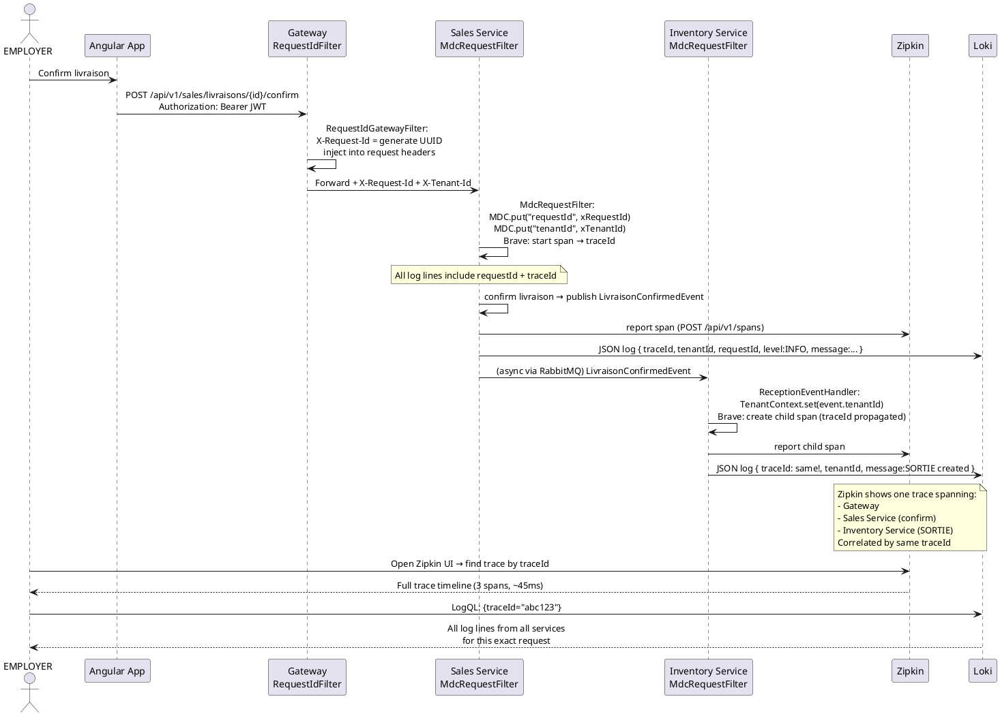

---

<a name="conclusion"></a>
# General Conclusion

## Summary of Achievements

This Final Year Project delivered a complete, production-grade, open-source multi-tenant SaaS ERP/CRM platform for aluminum joinery companies. Developed across five XP releases over the 2025–2026 academic year, the platform addresses all ten identified requirements and validates 23 user stories totaling **151 story points**.

| Release | Key Deliverable | Tests | SP |
|---|---|---|---|
| R1 – Foundation | Multi-tenancy, Keycloak SSO, RBAC, hash-chain audit | TenantIsolationIT (6), HealthIT (1) | 26 |
| R2 – Business Core | CRM, Sales FSM, Inventory ledger, Purchasing, Aging | SalesFlowIT (8), AchatIT (5), UnitTests (4) | 39 |
| R3 – Customer/CMS | Public portal, PDF generation, SeaweedFS, Branding | Manual + E2E | 18 |
| R4 – AI Module | Price heuristic, EMA forecast, Mistral LLM, pgvector RAG | Pricing unit tests | 37 |
| R5 – Mobile/Ops | Flutter offline-sync, Loki/Zipkin/Prometheus, GitHub CI | CI pipeline | 31 |

## Technical Achievements

| Dimension | Achievement |
|---|---|
| **Multi-tenancy** | Three-layer isolation: ThreadLocal + Hibernate filter + PostgreSQL RLS — verified by Testcontainers integration tests |
| **Security** | Stateless JWT, Keycloak OIDC, 4-tier RBAC, `@PreAuthorize` method-level security, tamper-proof SHA-256 hash-chain audit log |
| **Business coverage** | Full sales lifecycle (7 entities), purchasing (4 entities), CRM (3 entities), inventory (2 entities), CMS (2 entities) |
| **AI** | Calibrated heuristic price engine (TND/m², 3 factors), EMA stock-out risk sigmoid, Prophet/Ridge sales forecast, XGBoost classifiers, IsolationForest anomaly detection, Mistral LLM, pgvector RAG |
| **Mobile** | Flutter PKCE auth, offline-first Drift/SQLite, barcode scanner, 30s background sync with 3-retry dead-letter handling |
| **Observability** | Structured JSON logs → Loki; Brave traces → Zipkin; Prometheus metrics → 3 Grafana dashboards; trace-to-log correlation via derived fields |
| **CI/CD** | GitHub Actions: 4 parallel jobs (Maven tests, Ruff lint, Angular prod build, Trivy CVE scan) |
| **FOSS** | All components under Apache 2.0, MIT, BSD-3, PostgreSQL, LGPL, or MPL licenses |

## Perspectives

1. **Kill Bill billing integration** — subscription and usage-based billing for the SaaS reseller model (planned for Phase 10).
2. **Real ML models** — replace heuristic pricing with XGBoost trained on accumulated `devis_lines`; upgrade RAG embedder from placeholder to `paraphrase-multilingual-MiniLM-L12-v2` for semantic French/Arabic search.
3. **Prophet in production** — activate full Prophet model (currently using Ridge fallback in Docker slim) once tenants have ≥ 2 years of data and Stan/CmdStan is available in the build environment.
4. **Kubernetes deployment** — migrate from Docker Compose to Helm chart + Kubernetes for horizontal pod autoscaling and zero-downtime rolling updates.
5. **Push notifications** — complete FCM integration in `NotificationService.dart` (currently stubbed, pending `google-services.json` and flutterfire configure for each tenant's Firebase project).
6. **Multi-region tenancy** — geographic data residency for tenants in different countries (EU vs. MENA) using PostgreSQL tablespace routing.

---

*Report produced: June 2026*
*Repository root:* `C:\PFA2026` *(monorepo)*
*Stack:* Spring Boot 3.3 · Angular 17 · Flutter 3.22 · FastAPI 0.111 · PostgreSQL 16 · Keycloak 24
*All source code license: Apache 2.0*
