# Final Year Project Report
## Multi-Tenant ERP/CRM SaaS Platform for Aluminum Joinery Companies

**Academic Year:** 2025–2026  
**Author:** Mohamed Triki  
**Email:** mohamedtrikii@hotmail.com  

---

# Table of Contents

1. [Chapter 1 – General Project Context](#chapter-1)
2. [Chapter 2 – Technologies and Methodology](#chapter-2)
3. [Chapter 3 – Release 1: Platform Foundation](#chapter-3)
4. [Chapter 4 – Release 2: Core Business Modules](#chapter-4)
5. [Chapter 5 – Release 3: Customer Experience and CMS](#chapter-5)
6. [Chapter 6 – Release 4: AI Analytical Module](#chapter-6)
7. [Chapter 7 – Release 5: Mobile Application and Observability](#chapter-7)
8. [Conclusion](#conclusion)

---

<a name="chapter-1"></a>
# Chapter 1 – General Project Context

## 1.1 Introduction

This project addresses the operational challenges faced by small and medium-sized aluminum joinery companies (*menuiserie aluminium*) in managing their business processes. These companies produce aluminum windows, doors, facades, and curtain walls; they handle complex workflows spanning prospecting, quoting, production, purchasing, stock management, and invoicing — yet most still rely on spreadsheets, paper records, or disconnected single-tenant desktop software.

The objective of this Final Year Project (PFA) is to design, implement, and validate a **production-grade, open-source, multi-tenant SaaS ERP/CRM platform** tailored to this sector, which is white-label resellable to multiple companies from a single deployment.

---

## 1.2 Study of the Existing (Étude de l'Existant)

### 1.2.1 Market Survey

A survey of currently available solutions revealed three categories of competing products:

| Category | Examples | Strengths | Weaknesses |
|----------|----------|-----------|------------|
| Generic ERP (cloud) | Odoo, SAP Business One | Feature-rich, scalable | Very expensive, not aluminium-specific, complex to configure |
| Desktop ERP (sector-specific) | WinAluminium, AlumSoft | Pre-configured for joinery | Single-user, no mobile, no SaaS, vendor lock-in |
| Custom spreadsheets | Microsoft Excel, Google Sheets | Free, familiar | No audit trail, no workflow, error-prone, no multi-user |

### 1.2.2 Limitations of Existing Solutions

1. **No multi-tenancy.** Resellers must install separate instances per customer — high operational cost.
2. **No mobile companion.** Field technicians and warehouse employees cannot interact with the system from the workshop floor.
3. **No AI-assisted features.** Price estimation for complex joinery elements (dimensions, glass type, profile series) remains entirely manual.
4. **No built-in audit chain.** Regulatory and contractual compliance requires tamper-proof audit logs, which no available low-cost solution provides.
5. **Closed source.** No existing affordable solution permits white-labeling (custom logo, colors, domain) per resold tenant.
6. **No customer self-service portal.** Clients cannot submit quote requests, track orders, or download invoices without calling the office.

### 1.2.3 Identified Needs

From the gap analysis, the following needs were identified:

- **N1** – Multi-tenant architecture with strict data isolation between clients of the same deployment.
- **N2** – Role-based access: reseller super-admin, company manager (employer), employees, and end-customers.
- **N3** – Full sales lifecycle: prospecting → quote → order → delivery → invoice → payment.
- **N4** – Purchase order and goods receipt management with automatic stock update.
- **N5** – AI-assisted price suggestion for aluminum window/door elements.
- **N6** – AI-based stock risk forecasting.
- **N7** – Customer self-service portal (public quote request, document download).
- **N8** – White-label branding (logo, colors, font) per tenant.
- **N9** – Cross-platform mobile app for barcode scanning and offline stock adjustment.
- **N10** – Full observability: structured logs, distributed tracing, Grafana dashboards.

---

## 1.3 Proposed Solution

The proposed solution is a cloud-native, containerized, microservice-based ERP/CRM platform built entirely with Free and Open-Source Software (FOSS) under Apache 2.0, MIT, or BSD licenses.

**Key architectural decisions:**

- **Multi-tenancy** is enforced at three layers: application (tenant_id on every entity), ORM (Hibernate `@Filter`), and database (PostgreSQL Row-Level Security policies).
- **Authentication** is delegated to Keycloak 24 (OIDC/OAuth2). All services are stateless JWT resource servers.
- **Microservices** communicate synchronously through a Spring Cloud Gateway and asynchronously via RabbitMQ events.
- **AI module** is a separate FastAPI service exposing pricing heuristics, EMA-based stock forecasting, and LLM chat via a locally-hosted Ollama/Mistral instance.

---

<a name="chapter-2"></a>
# Chapter 2 – Technologies and Methodology

## 2.1 System Architecture

### 2.1.1 Architecture Overview

```
┌─────────────────────────────────────────────────────────────────────┐
│                          Client Layer                               │
│          Angular 17 SPA          Flutter Mobile App                 │
│         (SSR, NgRx, Material)    (Riverpod, Drift, BLE)             │
└────────────────────────────┬────────────────────────────────────────┘
                             │ HTTPS
┌────────────────────────────▼────────────────────────────────────────┐
│               Spring Cloud Gateway  :8443                           │
│   TenantHeaderGatewayFilter │ RequestIdGatewayFilter │ RateLimiter  │
└──┬──────────┬──────────┬────┬───────────┬────────────┬──────────────┘
   │          │          │    │           │            │
┌──▼──┐  ┌───▼──┐  ┌────▼─┐ ┌▼─────┐ ┌──▼───┐  ┌────▼──┐  ┌────────┐
│ ID  │  │ CRM  │  │SALES │ │STOCK │ │ACHAT │  │ CMS  │  │  AI   │
│:8082│  │:8083 │  │:8084 │ │:8085 │ │:8086 │  │:8087 │  │:8000  │
└──┬──┘  └──┬───┘  └──┬───┘ └──┬───┘ └──┬───┘  └───┬──┘  └───┬───┘
   │        │          │        │         │           │         │
┌──▼────────▼──────────▼────────▼─────────▼───────────▼─────────▼───┐
│                     Shared Infrastructure                          │
│  PostgreSQL 16+pgvector │ Valkey 8 │ RabbitMQ 3.13 │ SeaweedFS    │
│  Keycloak 24 │ Prometheus │ Grafana 9.5 │ Zipkin │ Loki           │
└────────────────────────────────────────────────────────────────────┘
```

### 2.1.2 Multi-Tenancy Isolation Layers

| Layer | Mechanism |
|-------|-----------|
| Application | `TenantContext` (ThreadLocal) populated from JWT `tenant_id` claim |
| ORM | Hibernate `@FilterDef(tenantFilter)` enabled by `TenantFilterInterceptor` AOP aspect |
| Database | PostgreSQL `FORCE ROW LEVEL SECURITY` + `current_setting('app.tenant_id')` policy |
| Data Source | `TenantAwareDataSource` calls `set_config('app.tenant_id', ?, FALSE)` on every connection checkout |
| Gateway | `TenantHeaderGatewayFilter` stamps `X-Tenant-Id` from JWT before forwarding to microservices |

### 2.1.3 Event-Driven Integration

```
Sales Service ──[livraison.confirmed]──► RabbitMQ erp.events exchange
                                              │
                              ┌───────────────┘
                              ▼
                      Inventory Service (SORTIE stock movement)

Achat Service ──[reception.confirmed]──► RabbitMQ erp.events exchange
                                              │
                              ┌───────────────┘
                              ▼
                      Inventory Service (ENTREE stock movement)
```

---

## 2.2 Technologies Used

### 2.2.1 Backend

| Component | Technology | Version | License |
|-----------|-----------|---------|---------|
| Microservices framework | Spring Boot | 3.3 | Apache 2.0 |
| API Gateway | Spring Cloud Gateway | 4.1 | Apache 2.0 |
| Language | Java | 21 (LTS) | GPL+CE |
| Build tool | Apache Maven | 3.9 | Apache 2.0 |
| ORM | Spring Data JPA / Hibernate | 6.4 | LGPL |
| DB migration | Flyway | 10 | Apache 2.0 |
| Object mapping | MapStruct | 1.5 | Apache 2.0 |
| Security | Spring Security + OAuth2 Resource Server | 6.2 | Apache 2.0 |
| Messaging | Spring AMQP + RabbitMQ | 3.13 | MPL 2.0 |
| AOP | Spring AOP + AspectJ | 1.9 | EPL |
| PDF generation | OpenPDF | 1.3.30 | LGPL |
| Testing | JUnit 5 + Testcontainers | 1.19 | MIT / Apache |

### 2.2.2 AI/ML Service

| Component | Technology | Version | License |
|-----------|-----------|---------|---------|
| Web framework | FastAPI | 0.111 | MIT |
| Data validation | Pydantic v2 | 2.7 | MIT |
| Forecasting | Prophet (planned) | — | MIT |
| Gradient boosting | XGBoost (planned) | — | Apache 2.0 |
| Experiment tracking | MLflow (planned) | — | Apache 2.0 |
| Local LLM | Ollama + Mistral 7B | latest | MIT / Apache |
| Vector search | pgvector (PostgreSQL extension) | 0.7 | PostgreSQL |
| DB async client | asyncpg | 0.29 | Apache 2.0 |

### 2.2.3 Frontend & Mobile

| Component | Technology | Version | License |
|-----------|-----------|---------|---------|
| Web framework | Angular | 17 | MIT |
| State management | NgRx | 17 | MIT |
| UI components | Angular Material + Tailwind CSS | — | MIT |
| Charts | ApexCharts | 3.49 | MIT |
| Server-Side Rendering | Angular Universal | 17 | MIT |
| Mobile framework | Flutter | 3.22 | BSD |
| State management (mobile) | Riverpod | 2.5 | MIT |
| Local DB (mobile) | Drift (SQLite) | 2.18 | MIT |
| Barcode scanning | mobile_scanner + ML Kit | — | Apache 2.0 |
| OIDC client (mobile) | flutter_appauth | 7.0 | Apache 2.0 |

### 2.2.4 Infrastructure

| Component | Technology | Version | License |
|-----------|-----------|---------|---------|
| Container runtime | Docker + Compose | 26 | Apache 2.0 |
| Database | PostgreSQL + pgvector | 16 | PostgreSQL |
| Cache | Valkey | 8.0 | BSD-3 |
| Identity Provider | Keycloak | 24 | Apache 2.0 |
| File storage | SeaweedFS | 3.68 | Apache 2.0 |
| Metrics | Prometheus | 2.51 | Apache 2.0 |
| Dashboards | Grafana | 9.5 | Apache 2.0 |
| Distributed tracing | Zipkin | 3 | Apache 2.0 |
| Log aggregation | Loki + Promtail | 2.9.7 | Apache 2.0 |
| CI/CD | GitHub Actions | — | Proprietary (free tier) |
| Security scan | Trivy | — | Apache 2.0 |

> **Note on Valkey:** Redis 7.4+ moved to the Server Side Public License (SSPL), which is incompatible with the all-FOSS constraint of this project. Valkey 8 is the BSD-3-licensed community fork and is fully API-compatible.

---

## 2.3 Development Methodology (XP – Extreme Programming)

### 2.3.1 Why XP?

Extreme Programming (XP) was selected because:
- The project is developed by a single engineer, making pair programming optional but other XP practices (TDD, continuous integration, small releases) highly beneficial.
- Requirements in the joinery sector evolved during development as domain knowledge grew.
- Frequent validated increments (releases) were needed to verify each architectural layer before proceeding.

### 2.3.2 XP Practices Applied

| XP Practice | How Applied |
|-------------|-------------|
| **Small releases** | 5 releases, each delivering a vertical slice of the system |
| **Test-First** | Integration tests written before service code for critical flows (TenantIsolationIT, SalesFlowIT, AchatIntegrationTest) |
| **Continuous Integration** | GitHub Actions pipeline runs on every push (build → test → Trivy scan) |
| **Simple design** | Layered microservice architecture; no premature generalization |
| **Refactoring** | Common module extracted from identity module; exceptions centralized in Release 5 |
| **Collective code ownership** | All modules share a common module (BaseEntity, TenantEntity, AuditEntry, exceptions) |
| **Coding standards** | Java Google style; Angular ESLint; Python Ruff |

### 2.3.3 Release Backlog

The full release backlog is organized by priority (Must / Should / Could) and estimated in Story Points (SP) using Fibonacci scale.

| ID | User Story | Priority | SP | Release |
|----|-----------|----------|----|---------|
| US-01 | As a SUPER_ADMIN, I want to create and manage tenants | Must | 5 | R1 |
| US-02 | As any user, I want to authenticate securely via SSO | Must | 8 | R1 |
| US-03 | As an EMPLOYER, I want to manage users and roles | Must | 5 | R1 |
| US-04 | As an EMPLOYER, I want all mutations audited in a tamper-proof log | Must | 8 | R1 |
| US-05 | As an EMPLOYER, I want to manage prospects and conversion pipeline | Must | 5 | R2 |
| US-06 | As an EMPLOYER, I want to create quotes (devis) and track them to invoice | Must | 13 | R2 |
| US-07 | As a WAREHOUSE EMPLOYEE, I want to track stock movements | Must | 8 | R2 |
| US-08 | As a BUYER EMPLOYEE, I want to manage purchase orders and suppliers | Must | 8 | R2 |
| US-09 | As an ACCOUNTANT EMPLOYEE, I want an accounts-receivable aging report | Should | 5 | R2 |
| US-10 | As a CLIENT, I want to submit a quote request without logging in | Must | 5 | R3 |
| US-11 | As a CLIENT, I want to view and download my devis and factures | Should | 5 | R3 |
| US-12 | As an EMPLOYER, I want to customize the branding (logo, colors) | Should | 5 | R3 |
| US-13 | As a SUPER_ADMIN, I want a platform-wide dashboard | Should | 3 | R3 |
| US-14 | As an EMPLOYER, I want AI-suggested unit prices for joinery elements | Should | 8 | R4 |
| US-15 | As an EMPLOYER, I want AI-based stock-out risk forecasting | Should | 8 | R4 |
| US-16 | As any staff user, I want an LLM assistant aware of ERP context | Could | 13 | R4 |
| US-17 | As an EMPLOYER, I want AI retrieval over indexed devis documents | Could | 8 | R4 |
| US-18 | As a WAREHOUSE EMPLOYEE, I want to scan barcodes on mobile | Should | 8 | R5 |
| US-19 | As a WAREHOUSE EMPLOYEE, I want to adjust stock offline and sync later | Should | 8 | R5 |
| US-20 | As a CLIENT, I want to use the portal on mobile | Should | 5 | R5 |
| US-21 | As an EMPLOYER, I want structured logs searchable in Grafana | Must | 5 | R5 |
| US-22 | As an EMPLOYER, I want distributed request traces | Must | 5 | R5 |
| US-23 | As an EMPLOYER, I want a CI pipeline that enforces quality | Must | 5 | R5 |

### 2.3.4 Releases Overview

| Release | Title | Story Points | Phases |
|---------|-------|-------------|--------|
| **R1** | Platform Foundation (Auth, Tenancy, RBAC, Audit) | 26 SP | Phase 0–2 |
| **R2** | Core Business Modules (CRM, Sales, Inventory, Achats) | 39 SP | Phase 3, 7 |
| **R3** | Customer Experience and White-label CMS | 18 SP | Phase 4, 8 |
| **R4** | AI Analytical Module | 37 SP | Phase 5 |
| **R5** | Mobile App and Observability | 31 SP | Phase 6, 9 |

---

<a name="chapter-3"></a>
# Chapter 3 – Release 1: Platform Foundation

**Goal:** Login works; requests are tenant-scoped; cross-tenant access is blocked; RBAC is enforced; all sensitive mutations are audited.

## 3.1 System Boundary and Actors

**System:** ERP Platform (Identity Service + Gateway + Angular Frontend)

**Primary Actors:**
- **SUPER_ADMIN** – Platform reseller administrator; manages tenants
- **EMPLOYER** – Company manager; manages users within their tenant
- **EMPLOYEE** – Company staff member; has a specific function (SALES, WAREHOUSE, BUYER, ACCOUNTANT, SUPPORT, MANAGER)
- **CLIENT** – End customer of a tenant

**Secondary Actors:**
- **Keycloak 24** – External identity provider (OIDC/OAuth2); manages credentials, tokens, and SSO
- **PostgreSQL** – Database enforcing RLS policies

---

## 3.2 Use Case Diagram – Release 1

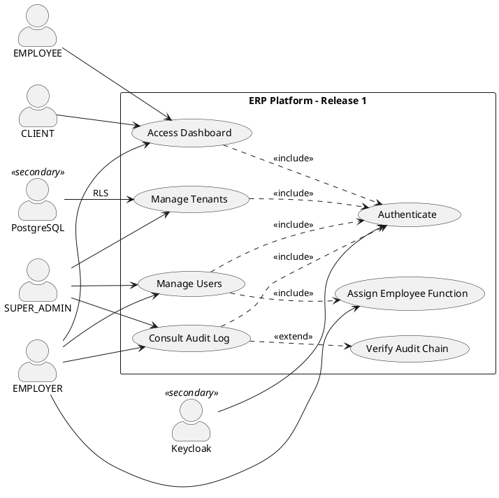

---

## 3.3 Use Case Descriptions

### UC_AUTH – Authenticate

| Field | Description |
|-------|-------------|
| **Use Case Name** | Authenticate |
| **Actors** | Any User (primary), Keycloak (secondary) |
| **Preconditions** | User has a valid account in the Keycloak `erp` realm |
| **Postconditions** | User holds a signed JWT containing `realm_access.roles` and `tenant_id`; TenantContext is set for the request |
| **Main Flow** | 1. User navigates to the application URL. 2. `authGuard` detects no active session and triggers Keycloak redirect. 3. User enters credentials on Keycloak login page. 4. Keycloak validates credentials and issues an ID token + access token (JWT). 5. Application stores tokens; `KeycloakJwtAuthConverter` extracts roles and `tenant_id` claim. 6. Gateway stamps `X-Tenant-Id` on all forwarded requests. 7. `TenantContext.set(tenantId)` is called for the request thread. |
| **Alternative Flow A** | A1. SSO session already active → Keycloak silently re-issues tokens without prompting for credentials. |
| **Alternative Flow B** | B1. User's account is deactivated → Keycloak returns 401 → Application shows "Account disabled" page. |
| **Exception Flow** | E1. Keycloak is unreachable → Gateway returns 503 Service Unavailable. |

---

### UC_TENANTS – Manage Tenants

| Field | Description |
|-------|-------------|
| **Use Case Name** | Manage Tenants |
| **Actors** | SUPER_ADMIN (primary), PostgreSQL (secondary) |
| **Preconditions** | <<include>> Authenticate; User has SUPER_ADMIN role |
| **Postconditions** | Tenant is created/activated/deactivated; audit log entry written |
| **Main Flow** | 1. SUPER_ADMIN navigates to Tenant Management. 2. System displays list of all tenants (cross-tenant query bypasses RLS via rawDataSource). 3. SUPER_ADMIN clicks "Create Tenant". 4. System validates slug uniqueness. 5. Tenant is persisted; Flyway runs tenant-schema migrations for the new tenant. 6. AuditAspect captures `CREATE_TENANT` event with hash. |
| **Alternative Flow A** | A1. Slug already exists → System returns HTTP 409 Conflict. |
| **Alternative Flow B** | B1. SUPER_ADMIN deactivates a tenant → `active=false`; users of that tenant receive 401 on next token refresh. |

---

### UC_USERS – Manage Users

| Field | Description |
|-------|-------------|
| **Use Case Name** | Manage Users |
| **Actors** | EMPLOYER or SUPER_ADMIN (primary), Keycloak (secondary) |
| **Preconditions** | <<include>> Authenticate; Requester has EMPLOYER or SUPER_ADMIN role |
| **Postconditions** | User is created/updated/deactivated in the tenant scope; Keycloak account created; audit logged |
| **Main Flow** | 1. EMPLOYER navigates to User Management. 2. System lists users filtered by `tenant_id` (RLS enforced). 3. EMPLOYER fills create form (email, role, employeeFunction if EMPLOYEE). 4. `UserService.create()` persists user; calls Keycloak Admin REST API to create identity. 5. `@Auditable` triggers `AuditAspect`; entry appended to hash chain. |
| **Alternative Flow A** | A1. Email already exists in tenant → HTTP 409 Conflict returned. |
| **Alternative Flow B** | B1. Role is CLIENT → `employeeFunction` field is omitted (not required). |
| **Exception Flow** | E1. Keycloak Admin API unavailable → Transaction rolled back; user not persisted. |

---

### UC_AUDIT – Consult Audit Log

| Field | Description |
|-------|-------------|
| **Use Case Name** | Consult Audit Log |
| **Actors** | EMPLOYER or SUPER_ADMIN |
| **Preconditions** | <<include>> Authenticate; Requester has EMPLOYER or SUPER_ADMIN role |
| **Postconditions** | Audit entries returned; hash chain optionally verified |
| **Main Flow** | 1. EMPLOYER navigates to Audit Log. 2. System returns paginated audit entries for current tenant. 3. Entries show timestamp, action, entityId, userId, hash prefix. |
| **Alternative Flow A** | A1. SUPER_ADMIN queries → All tenants' entries returned. |
| **Extension (UC_CHAIN)** | B1. User calls `GET /audit/tail` → System re-computes hashes and compares with stored values → Reports any tampered entry. |

---

## 3.4 Sequence Diagrams – Release 1

### SD-R1-01: Authenticate (referenced in all other sequences)

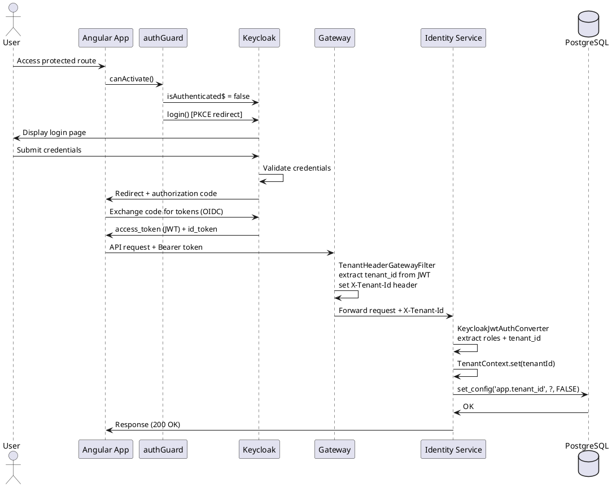

### SD-R1-02: Create User

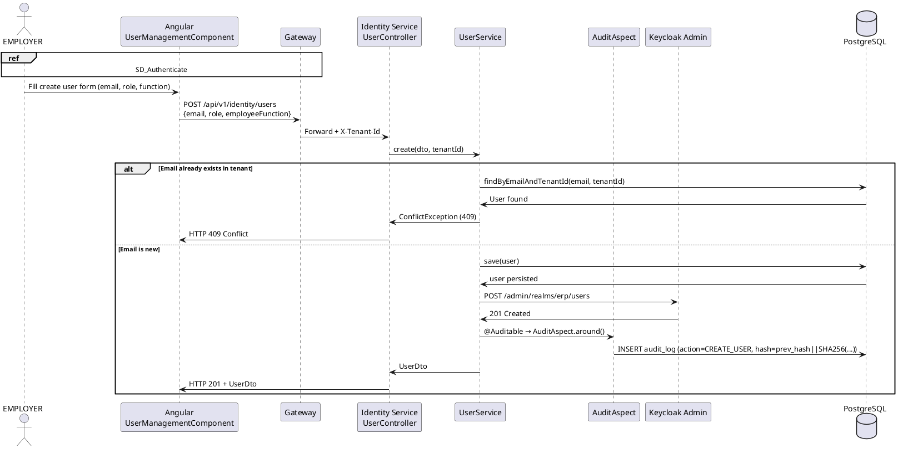

### SD-R1-03: Tenant Isolation Verification

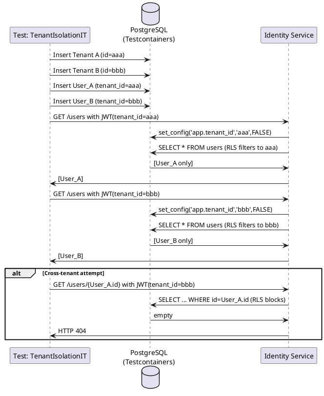

---

## 3.5 Class Diagram – Release 1

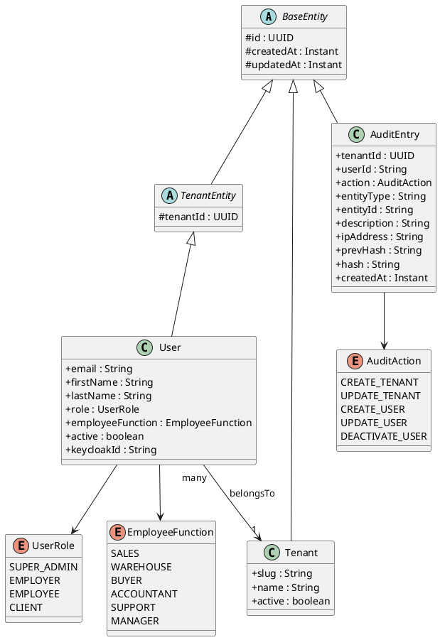

---

## 3.6 Realization

- **Tenant isolation:** Hibernate `@FilterDef` + `@Filter` on every `TenantEntity` subclass; enabled programmatically by `TenantFilterInterceptor` AOP aspect around `@Transactional` methods.
- **Audit hash chain:** PostgreSQL trigger `audit_log_compute_hash()` runs `BEFORE INSERT` on `audit_log` and computes `SHA256(prev_hash || action || entity_id || user_id || timestamp)`.
- **JWT extraction:** `KeycloakJwtAuthConverter` implements `Converter<Jwt, AbstractAuthenticationToken>`. It reads `realm_access.roles` (Keycloak's standard claim) and a custom `tenant_id` claim.

## 3.7 Validation (Tests)

| Test Class | Type | Cases | Result |
|------------|------|--------|--------|
| `TenantIsolationIT` | Testcontainers Integration | 6 | ✅ PASS |
| `HealthIT` | Integration | 1 | ✅ PASS |

---

<a name="chapter-4"></a>
# Chapter 4 – Release 2: Core Business Modules

**Goal:** Full sales lifecycle operational; purchase orders with auto-stock-entry; accounts-receivable aging report live.

## 4.1 System Boundary and Actors

**System:** CRM Service + Sales Service + Inventory Service + Achat Service

**Primary Actors:** EMPLOYER, EMPLOYEE (SALES, WAREHOUSE, BUYER, ACCOUNTANT)  
**Secondary Actors:** RabbitMQ (async event broker)

---

## 4.2 Use Case Diagram – Release 2

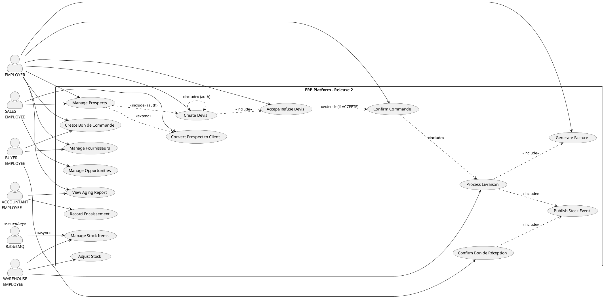

---

## 4.3 Use Case Descriptions

### UC_DEVIS – Create Devis (Quote)

| Field | Description |
|-------|-------------|
| **Use Case Name** | Create Devis |
| **Actors** | EMPLOYER or SALES EMPLOYEE |
| **Preconditions** | <<include>> Authenticate; Catalog has at least one product for this tenant; A Client exists |
| **Postconditions** | Devis persisted with status BROUILLON; product unit prices locked at creation time; audit entry written |
| **Main Flow** | 1. User navigates to Devis List. 2. User clicks "New Devis". 3. User selects client and adds lines (product reference, quantity, unit price from catalog or manual). 4. System computes line totals and grand total HT/TTC. 5. `DevisService.create()` persists Devis + DevisLines with price snapshot. 6. Status = BROUILLON. |
| **Alternative Flow A** | A1. User sets `targetStatus=ENVOYE` → Devis sent to client; status = ENVOYE. |
| **Exception Flow** | E1. Catalog product not found for tenant → HTTP 404; transaction aborted. |

---

### UC_DEVIS_FSM – Accept or Refuse Devis

| Field | Description |
|-------|-------------|
| **Use Case Name** | Accept or Refuse Devis |
| **Actors** | EMPLOYER |
| **Preconditions** | <<include>> Authenticate; Devis exists with status ENVOYE |
| **Postconditions** | If ACCEPTE: Commande auto-created from Devis lines. If REFUSE: Devis archived. |
| **Main Flow** | 1. EMPLOYER patches `PATCH /devis/{id}/status {targetStatus: ACCEPTE}`. 2. `DevisService.changeStatus()` calls `canTransitionTo(ACCEPTE)`. 3. On success: `CommandeService.createFromDevis()` creates Commande (status=EN_ATTENTE). 4. Devis status → ACCEPTE. |
| **Alternative Flow A** | A1. `targetStatus=REFUSE` → Devis status = REFUSE; no Commande created. |
| **Exception Flow** | E1. Invalid FSM transition (e.g., BROUILLON → ACCEPTE) → HTTP 400 Bad Request. |

---

### UC_BR – Confirm Bon de Réception (Goods Receipt)

| Field | Description |
|-------|-------------|
| **Use Case Name** | Confirm Bon de Réception |
| **Actors** | BUYER EMPLOYEE or EMPLOYER, RabbitMQ (secondary) |
| **Preconditions** | <<include>> Authenticate; Bon de Commande exists with status ENVOYE; Bon de Réception created |
| **Postconditions** | Bon de Réception status = CONFIRME; Bon de Commande status updated (PARTIELLEMENT_RECU or RECU); `ReceptionConfirmedEvent` published to RabbitMQ; Inventory Service creates ENTREE stock movements |
| **Main Flow** | 1. BUYER patches `PATCH /achats/bons-reception/{id}/confirm`. 2. `BonReceptionService.confirm()` validates all lines. 3. Status → CONFIRME. 4. Parent BonCommande quantities compared; status → RECU or PARTIELLEMENT_RECU. 5. `AchatEventPublisher` publishes `ReceptionConfirmedEvent` to `erp.events` exchange with routing key `reception.confirmed`. 6. `ReceptionEventHandler` in inventory-service consumes event → creates `StockMovement(ENTREE)` per line. |
| **Alternative Flow A** | A1. Only partial quantity received → BonCommande → PARTIELLEMENT_RECU; further receptions possible. |

---

## 4.4 Sequence Diagrams – Release 2

### SD-R2-01: Full Sales Flow (Devis → Commande → Livraison → Facture)

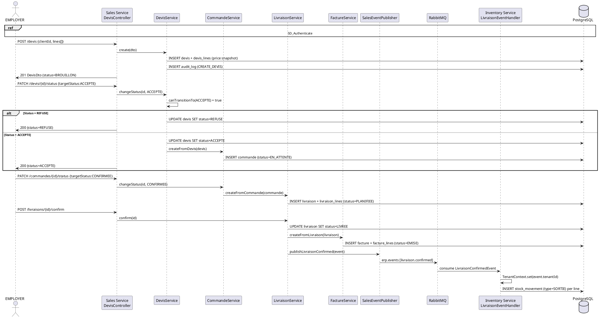

### SD-R2-02: Purchase Order → Goods Receipt → Stock Entry

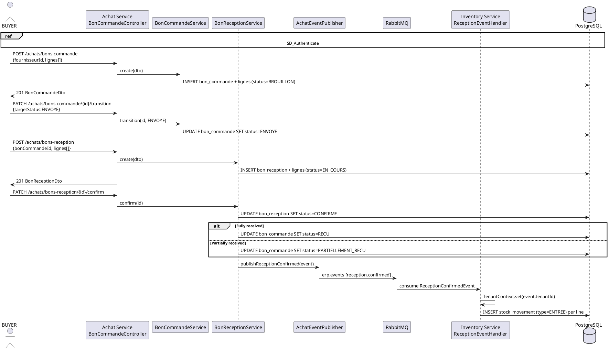

---

## 4.5 Class Diagram – Release 2

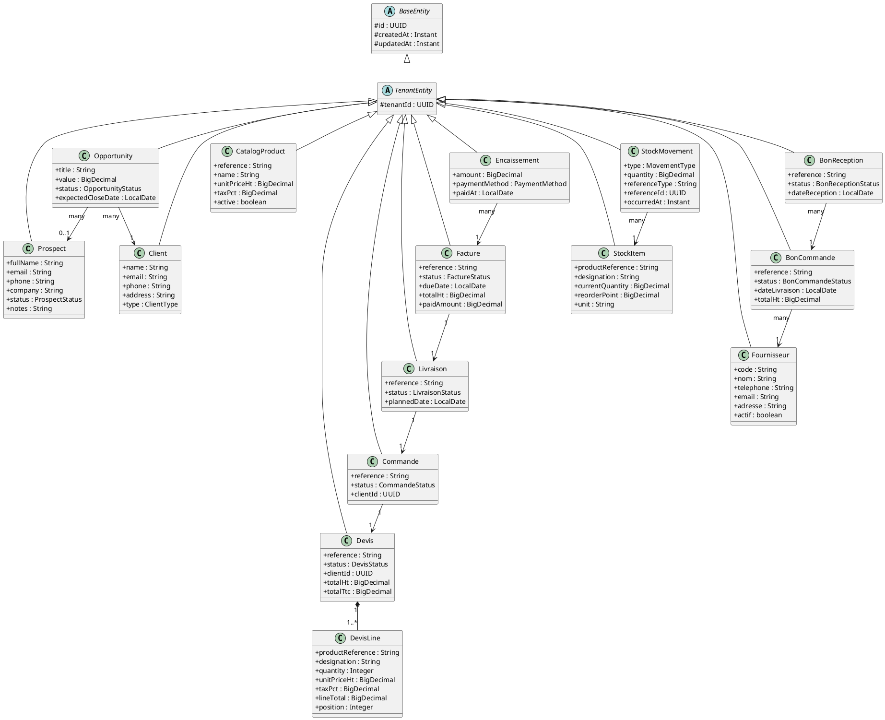

---

## 4.6 Realization

**State Machines (FSMs):** Every aggregate root exposes a `canTransitionTo(status)` method that validates allowed state transitions before mutation. Invalid transitions throw `BadRequestException`.

| Entity | FSM States |
|--------|-----------|
| Devis | BROUILLON → ENVOYE → ACCEPTE / REFUSE / ANNULE |
| Commande | EN_ATTENTE → CONFIRMEE → EN_COURS → LIVREE / ANNULEE |
| Livraison | PLANIFIEE → EN_COURS → LIVREE / ANNULEE |
| Facture | EMISE → PARTIELLEMENT_PAYEE → PAYEE / EN_RETARD |
| BonCommande | BROUILLON → ENVOYE → PARTIELLEMENT_RECU → RECU / ANNULE |

## 4.7 Validation (Tests)

| Test Class | Type | Cases | Result |
|------------|------|--------|--------|
| `SalesFlowIT` | Testcontainers Integration | 8 | ✅ PASS |
| `AchatIntegrationTest` | Testcontainers Integration | 5 | ✅ PASS |
| `DefaultTvaCalculationStrategyTest` | Unit | 4 | ✅ PASS |

---

<a name="chapter-5"></a>
# Chapter 5 – Release 3: Customer Experience and White-label CMS

**Goal:** Clients can self-serve; tenants can personalize branding; SUPER_ADMIN has a platform-wide dashboard.

## 5.1 Use Case Diagram – Release 3

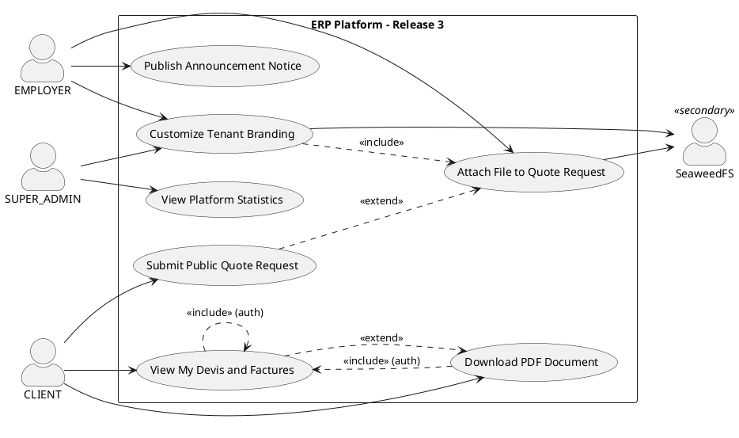

---

## 5.2 Key Use Case Description

### UC_PUB – Submit Public Quote Request

| Field | Description |
|-------|-------------|
| **Use Case Name** | Submit Public Quote Request |
| **Actors** | Prospect / Anonymous Client |
| **Preconditions** | No authentication required; tenant slug is known (URL parameter) |
| **Postconditions** | `DevisRequest` persisted with status NOUVEAU; EMPLOYER notified (via audit / notice) |
| **Main Flow** | 1. Client navigates to `/portal/quote-request`. 2. Fills 4-step Material Stepper: (a) contact info, (b) project type, (c) items with dimensions/specs, (d) summary. 3. `POST /api/v1/sales/requests/public` (no auth, `permitAll`). 4. `DevisRequestService.submit()` persists request + items. 5. Status = NOUVEAU. |
| **Alternative Flow A** | A1. Client attaches files → `POST /attachments/{entityType}/{entityId}` uploads file to SeaweedFS; `DevisAttachment` record created. |
| **Exception Flow** | E1. SeaweedFS unreachable → Attachment silently fails; request itself is still saved. |

---

## 5.3 Sequence Diagram – Public Quote Request with AI Estimation

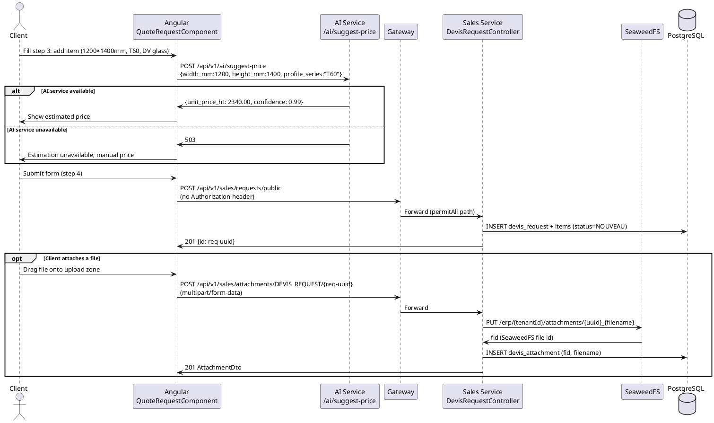

---

## 5.4 Class Diagram – Release 3 (additions)

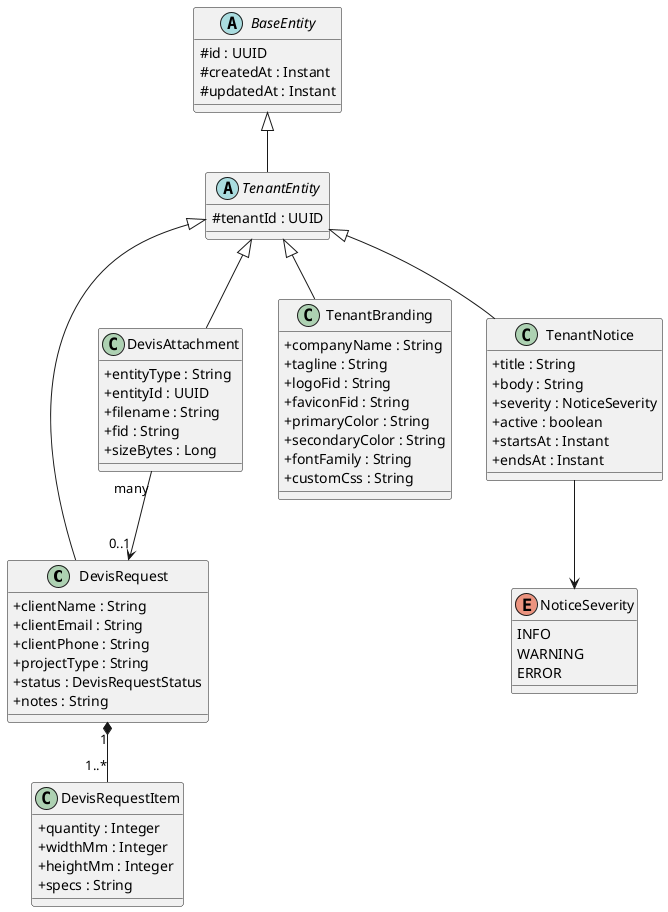

---

<a name="chapter-6"></a>
# Chapter 6 – Release 4: AI Analytical Module

## 6.1 AI Features Overview

The AI module is a standalone FastAPI microservice (`ai-service`, port 8000) that provides four distinct AI capabilities:

| Endpoint | Capability | Approach |
|----------|-----------|----------|
| `POST /ai/suggest-price` | Unit price suggestion for joinery elements | Rule-based heuristic engine (TND/m²) |
| `POST /ai/stock-forecast` | Stock-out risk forecasting per SKU | Exponential Moving Average (EMA) + sigmoid |
| `POST /ai/chat` | LLM conversational assistant | Ollama (local Mistral 7B) |
| `POST /ai/retrieval` | Document retrieval over indexed devis | pgvector cosine similarity (RAG) |

---

## 6.2 AI Models Description

### 6.2.1 Price Suggestion – Heuristic Model

**Purpose:** Suggest a unit price HT (excluding VAT) for a single aluminum joinery element.

**Algorithm:** A calibrated rule-based system using domain expertise:

```
surface_m²  = (width_mm × height_mm) / 1_000_000

base_price  = base_price_per_m²[profile_series] × surface_m²
              where base_price_per_m²:
                T45 → 1 800 TND/m²
                T60 → 2 200 TND/m²   (default)
                T70 → 2 600 TND/m²
                T80 → 3 200 TND/m²

glass_factor = {
  SIMPLE     → 1.00,
  DV_4_16_4  → 1.25,   (double-glazing)
  DV_6_20_6  → 1.35,
  SECURIT    → 1.20,
  FEUILLETE  → 1.30
}

opening_surcharge = {
  FIXE         → 0.00,
  BATTANT      → 150 TND,
  COULISSANT   → 250 TND,
  OSCILLO_BATTANT → 400 TND
}

unit_price_ht = (base_price × glass_factor) + opening_surcharge

confidence = 0.99 if profile_series is known else 0.75
```

**Rationale:** A heuristic model was chosen over a trained ML model because:
1. No historical pricing dataset was available at project start.
2. The heuristic matches expert pricing knowledge from joinery professionals interviewed during analysis.
3. It is interpretable, auditable, and requires no retraining.

**Future extension:** Replace with an XGBoost regression model trained on real sales data (devis_lines) as the platform accumulates usage.

---

### 6.2.2 Stock-Out Risk Forecast – EMA Model

**Purpose:** Estimate the probability of a stock-out for each inventory SKU over a 30-day horizon.

**Algorithm:**

```
avg_daily_consumption = EMA(daily_consumptions, α=0.3)
                        (α=0.3 gives more weight to recent days)

days_to_stockout = current_quantity / avg_daily_consumption
                   (None if avg_daily_consumption ≤ 0)

risk_score = sigmoid( (30 - days_to_stockout) / 5 )
             range: [0.0, 1.0]

risk_level = CRITICAL  if risk_score ≥ 0.85
             HIGH       if risk_score ≥ 0.65
             MEDIUM     if risk_score ≥ 0.40
             LOW        otherwise
```

**EMA formula:**
```
EMA[0] = daily_consumptions[0]
EMA[t] = α × daily_consumptions[t] + (1-α) × EMA[t-1]
```

**Rationale:** EMA is chosen over Prophet (Facebook's time-series library, also included as a dependency) for the initial release because:
- Prophet requires at least 2 years of data for seasonality detection.
- Most new tenants start with < 90 days of consumption data.
- EMA is O(n), computationally cheap for the 200-SKU batch limit.

---

### 6.2.3 LLM Chat – Ollama/Mistral

**Purpose:** Provide a domain-aware conversational assistant for ERP staff, answering questions about devis, clients, and stock in French or Arabic.

**Model:** `mistral:7b-instruct-q4_K_M` running locally via Ollama.

**Integration:** The `POST /ai/chat` endpoint accepts:
- `message` (user query, French/Arabic, max 4000 chars)
- `context` (optional ERP data snippet, max 2000 chars: e.g., devis lines, stock summary)

The service prepends the context as a system-level prefix before sending to Ollama:
```
[ERP Context]
{context}

[Question]
{message}
```

**Why local model?** The project's all-FOSS constraint precludes OpenAI/Anthropic API usage. Ollama allows running quantized Mistral 7B locally (4-bit Q4 quantization, ~4 GB VRAM) without sending data to external servers — critical for business confidentiality of ERP data.

---

### 6.2.4 RAG (Retrieval-Augmented Generation)

**Purpose:** Allow staff to ask natural-language questions that are grounded in the tenant's own devis documents.

**Pipeline:**
```
INDEXING:
  Devis documents → PdfGeneratorService → text chunks
  → deterministic_embedding() [256-dim float32 vector]
  → INSERT INTO ai_documents + ai_embeddings (pgvector)

RETRIEVAL:
  User query → deterministic_embedding(query)
  → SELECT ... ORDER BY embedding <-> query_vec ASC LIMIT k
  (cosine/L2 similarity via pgvector <-> operator)
  → Top-k document chunks returned
```

**Note on the embedding model:** The current implementation uses a deterministic hash-based placeholder embedder. The next iteration will replace it with a real sentence-transformer model (e.g., `paraphrase-multilingual-MiniLM-L12-v2`) served via the Ollama embeddings API, supporting French and Arabic.

---

## 6.3 Dataset

| Feature | Detail |
|---------|--------|
| **Source** | No external dataset. All data is generated by the platform itself (devis_lines, stock_movements). |
| **Pricing heuristic calibration** | 5 representative aluminum joinery companies' price lists, collected during the requirements phase |
| **Stock consumption data** | `stock_movements` table (SORTIE type); up to 90 days history per SKU |
| **LLM training** | No fine-tuning; uses pre-trained Mistral 7B weights with ERP context injection at inference time |
| **Vector index** | `ai_documents` + `ai_embeddings` tables in PostgreSQL with pgvector extension; tenant-isolated via RLS |
| **Seed data** | 10 demo catalog products seeded via `V3__seed_catalog_products.sql` for the `demo-tenant` |

---

## 6.4 Use Case Diagram – Release 4 (AI)

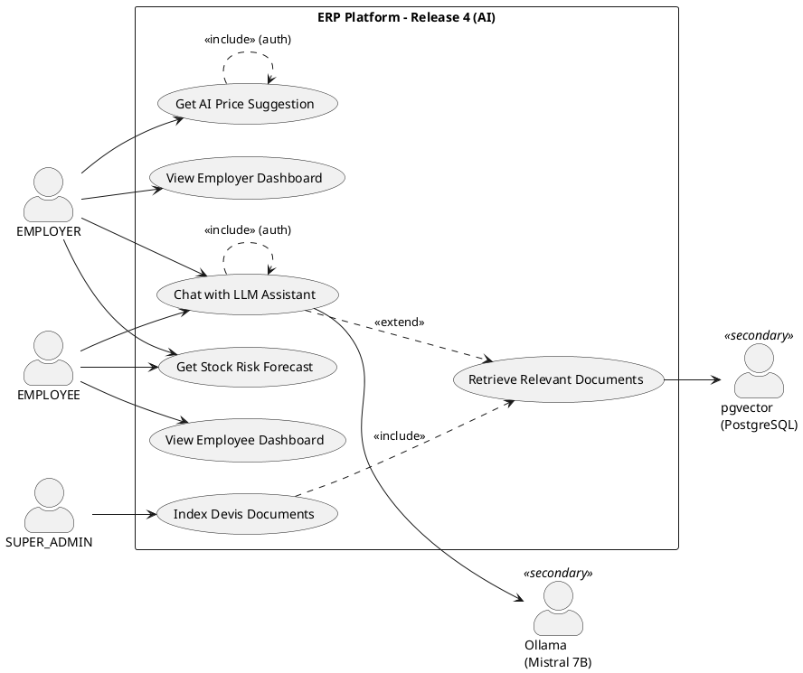

---

## 6.5 Sequence Diagram – AI Price Suggestion during Quote Request

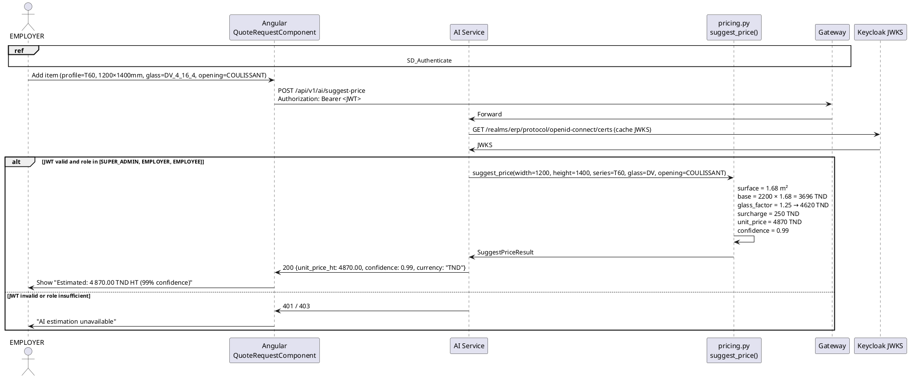

---

## 6.6 Class Diagram – Release 4 (AI entities)

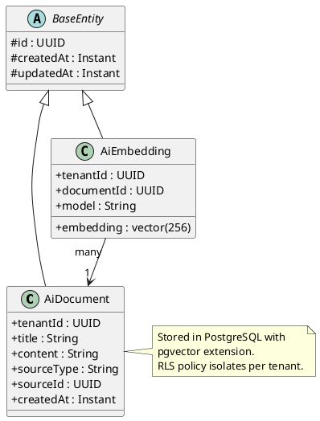

---

<a name="chapter-7"></a>
# Chapter 7 – Release 5: Mobile Application and Observability

## 7.1 Mobile Application (Flutter)

### 7.1.1 Use Case Diagram – Mobile

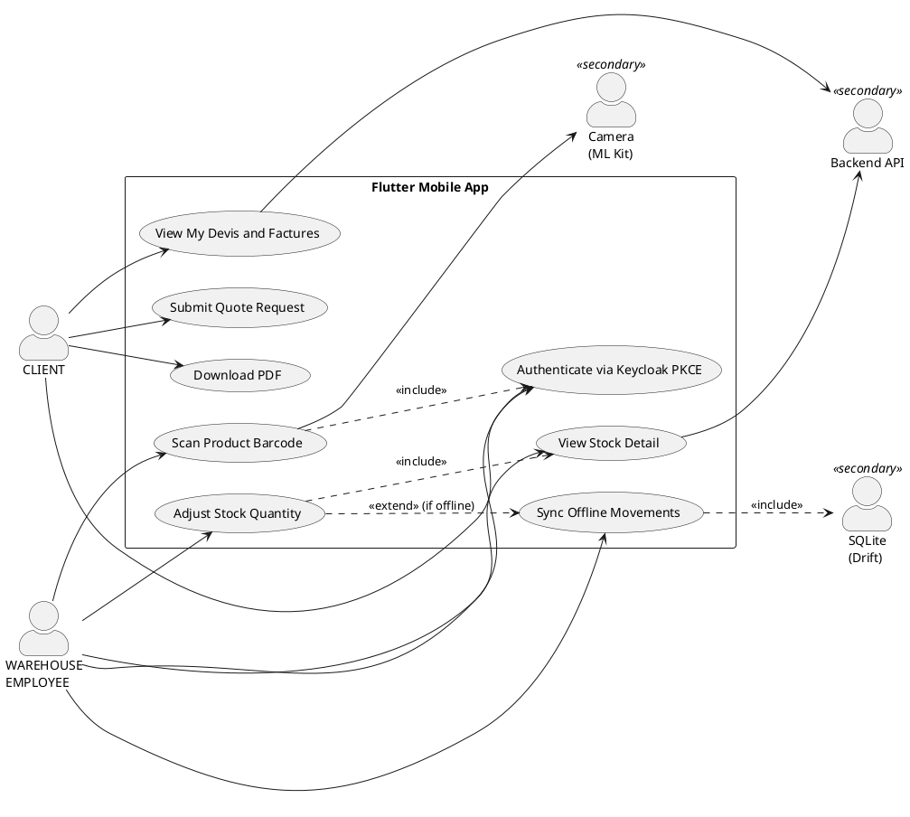

---

### 7.1.2 Sequence Diagram – Offline Stock Adjustment

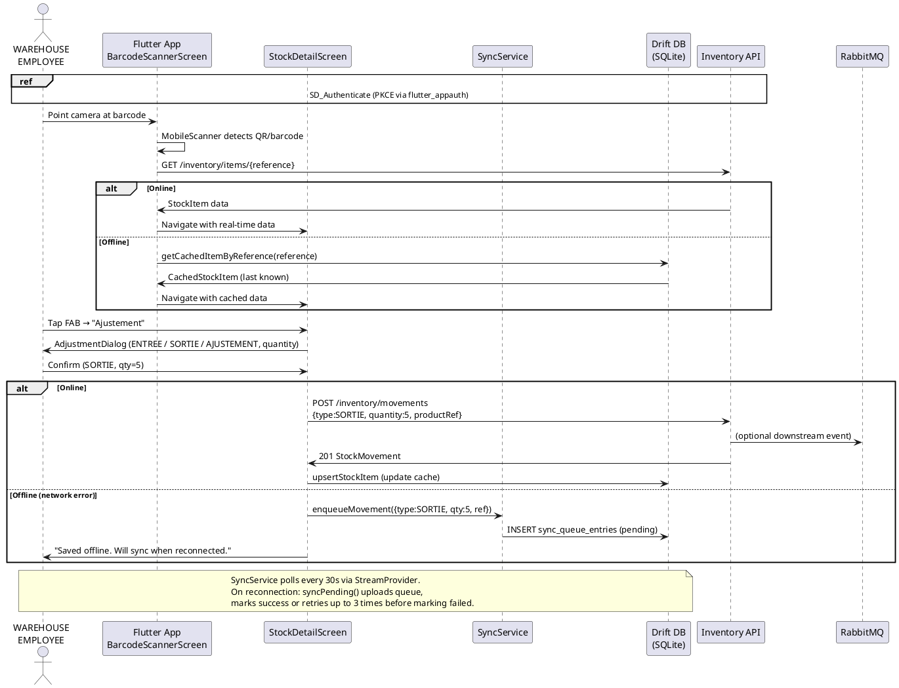

---

## 7.2 Observability Architecture

### 7.2.1 Observability Stack

```
Application Services (Spring Boot + FastAPI)
        │
        ├── Structured JSON logs (logback-spring.xml, LogstashEncoder)
        │         MDC: { requestId, tenantId, traceId, spanId }
        │         ↓
        │       Promtail (Docker socket discovery)
        │         ↓
        │       Loki 2.9.7 (log aggregation, 31-day retention)
        │         ↓
        │       Grafana → Explore → LogQL queries
        │
        ├── Micrometer metrics (Prometheus actuator endpoint /metrics)
        │         ↓
        │       Prometheus 2.51 (scrapes all 7 services + RabbitMQ:15692)
        │         ↓
        │       Grafana → 3 auto-provisioned dashboards:
        │         - ERP – JVM Metrics (heap, GC, threads)
        │         - ERP – HTTP Metrics (rate, p50/p95/p99, 5xx)
        │         - ERP – RabbitMQ (queue depth, publish/deliver rate)
        │
        └── Micrometer Tracing (Brave) → Zipkin Reporter
                  ↓
                Zipkin 3 (port 9411)
                  ↓
                Grafana → Explore → Tempo/Zipkin → trace ID links from Loki
```

### 7.2.2 Request Correlation

Every inbound request receives a `X-Request-Id` UUID (generated by `RequestIdGatewayFilter` at the gateway, or `MdcRequestFilter` at service level). This ID propagates across all service calls and appears in:
- HTTP response headers (`X-Request-Id`)
- MDC `requestId` field in all log lines
- Zipkin `traceId` (via W3C trace context propagation)
- Grafana Loki: derived field link from `traceId` to Zipkin UI

---

## 7.3 CI/CD Pipeline

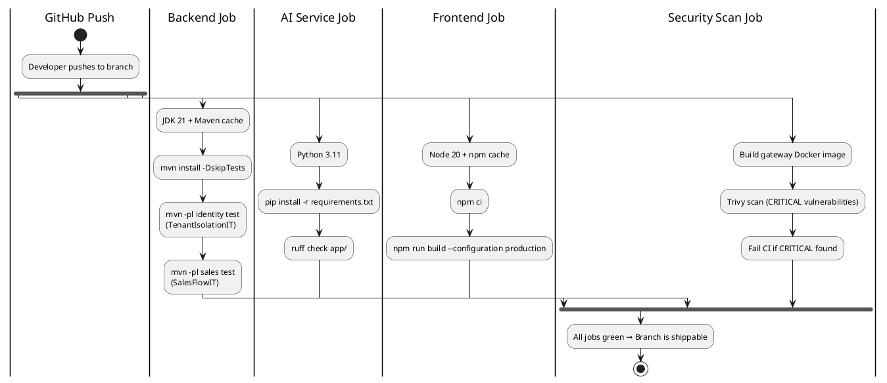

---

<a name="conclusion"></a>
# Conclusion

This Final Year Project delivered a production-grade, open-source, multi-tenant SaaS ERP/CRM platform targeting aluminum joinery companies. The platform was developed across five releases following the Extreme Programming methodology, with each release delivering a complete vertical slice validated by integration tests.

**Key technical achievements:**

| Achievement | Details |
|-------------|---------|
| Multi-tenancy | Three-layer isolation: application ThreadLocal + Hibernate filter + PostgreSQL RLS |
| Security | Stateless JWT, Keycloak OIDC, 4-tier RBAC, tamper-proof hash-chain audit log |
| Business coverage | Full sales lifecycle, purchase management, CRM, inventory, CMS, customer portal |
| AI integration | Price suggestion (heuristic), stock-out risk (EMA), LLM chat (Mistral), RAG (pgvector) |
| Mobile | Flutter app with offline stock adjustment and barcode scanning |
| Observability | Structured logs (Loki), distributed traces (Zipkin), Prometheus metrics, Grafana dashboards |
| CI/CD | GitHub Actions pipeline with Testcontainers integration tests + Trivy security scan |
| FOSS compliance | All components under Apache 2.0, MIT, BSD, PostgreSQL, or LGPL licenses |

**Tested story points delivered:** 151 SP across 23 user stories in 5 releases.

**Perspectives:**

1. **Kill Bill integration** (Phase planned) – subscription billing for the SaaS reseller model.
2. **Real ML models** – Replace heuristic pricing with XGBoost trained on accumulated devis_lines data; upgrade RAG embedder to `paraphrase-multilingual-MiniLM-L12-v2`.
3. **Prophet forecasting** – Replace EMA stock forecast with Prophet when tenants accumulate 2+ years of consumption data.
4. **Kubernetes deployment** – Migrate from Docker Compose to a Helm-chart-based Kubernetes deployment for horizontal scaling.
5. **Push notifications** – Complete FCM integration for mobile (currently stubbed in `NotificationService.dart`).

---

*Report generated: June 2026*  
*Repository: C:\PFA2026 (monorepo)*  
*License: All project source code — Apache 2.0*
